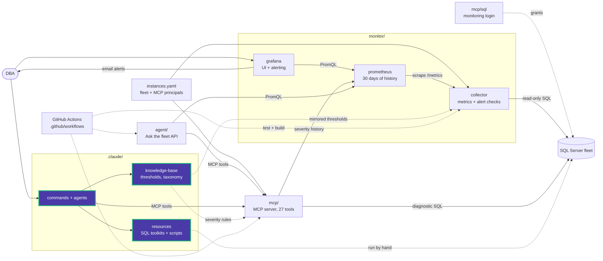

# .claude

The Claude Code toolkit for Data Eyes: agents, slash commands, a knowledge base, and
the SQL Server script library they use.

| Path | Contents |
|---|---|
| `agents/` | Agent definitions (see below) |
| [commands/](commands/) | The 12 slash commands (`/sql-performance`, `/sql-monitor`, `/status`, ...) |
| [knowledge-base/](knowledge-base/) | Thresholds, taxonomy, naming rules and methodology (`_static/`); per-database KBs built by `/sql-kb` |
| [resources/](resources/) | Performance and maintenance toolkits and the 84-script library |
| `settings.json` | Shared Claude Code permissions for this project |
| `settings.local.json` | Personal overrides (not shared) |

## Agents

Claude Code loads every `.md` file in `agents/` as an agent, so that folder has no
README of its own.

| Agent | Use it for |
|---|---|
| [sql-server-dba](agents/sql-server-dba.md) | Troubleshooting, performance tuning and maintenance. Prefers a live `data-eyes-mcp` tool call over reading a script |
| [dashboard-app](agents/dashboard-app.md) | The collector, Prometheus, Grafana and deployment configuration |

## Where to find an answer

The `sql-server-dba` agent looks in this order:

1. A live `data-eyes-mcp` tool, when an MCP server is reachable.
2. `knowledge-base/_static/` for the threshold or routing rule.
3. `resources/` for the script or the full write-up.

Scripts here are copy-paste safe. Anything that creates, alters or drops objects
needs your explicit confirmation before it runs.

<!-- project-map:start -->
## Where this fits

- Claude Code loads `agents/` and `commands/` when you open the repository.
- Commands and the `sql-server-dba` agent call the live `data-eyes-mcp` tools first (registered in `.mcp.json`), then fall back to `knowledge-base/` and `resources/`.
- `knowledge-base/_static/thresholds.yaml` is mirrored by the collector's alert catalog and MCP's diagnostic queries.



The highlighted box is this folder. Solid arrows are runtime calls; dotted arrows are configuration, mirrored rules, or manual use.

### In the repository

```text
data-eyes/
├── .claude/                                  Claude Code toolkit  ◀ you are here
│   ├── agents/                               sql-server-dba, dashboard-app
│   ├── commands/                             12 slash commands
│   ├── knowledge-base/                       Static KB + per-database KBs
│   └── resources/                            SQL toolkits and script library
├── .github/                                  GitHub configuration
├── agent/                                    "Ask the fleet" API
├── assets/                                   Logo
├── mcp/                                      MCP server (27 read-only tools)
├── monitor/                                  Collector -> Prometheus -> Grafana
├── .env.example                              Template for .env (Grafana, agent)
├── .mcp.json                                 Claude Code MCP registration (stdio, dev)
├── CLAUDE.md                                 Project instructions for Claude Code
├── README.md                                 Setup, configuration, security
├── docker-compose.yml                        The whole stack
└── instances.example.yaml                    Template for instances.yaml (fleet, MCP principals)
```
<!-- project-map:end -->
