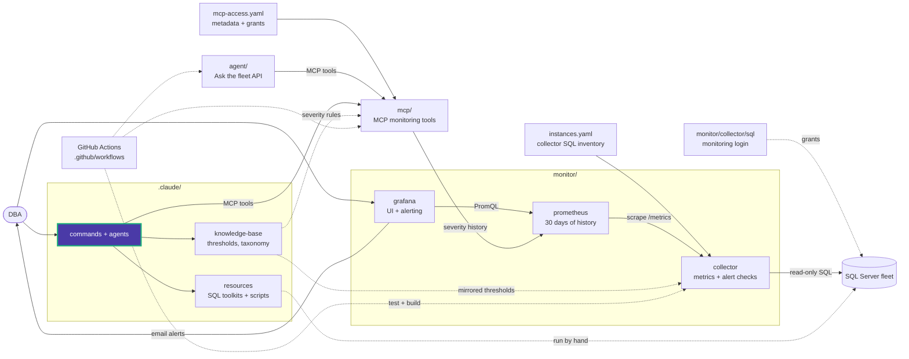

# Data Eyes Commands

**12 slash commands** for SQL Server monitoring, performance, maintenance, code review, visual reporting, and project management.

## DBA Operations (6)

| Command | Description |
|---------|-------------|
| `/sql-document` | Generate database documentation from catalog views |
| `/sql-maintenance` | Set up maintenance using Ola Hallengren scripts |
| `/sql-monitor` | Diagnose and configure the monitoring stack (collector, Prometheus, Grafana) |
| `/sql-performance` | Systematic performance tuning (10-step methodology) |
| `/sql-guidelines` | Review SQL against clean code guidelines |
| `/sql-scripts` | Find and adapt scripts from the 84-script library |

## Knowledge-Driven Review (2)

| Command | Description | Dependency |
|---------|-------------|------------|
| `/sql-kb` | Build knowledge base for a database (volumes, indexes) | Run first |
| `/sql-pr-review` | Review SQL changes against KB + guidelines + performance rules | Requires `/sql-kb` |

## Visual Reporting (1)

| Command | Description |
|---------|-------------|
| `/sql-visual-report` | Self-contained HTML report for performance tuning and maintenance changes. Data Eyes violet (`#4a3aa7`) + aqua (`#1baf7a`) branding. Supports `--branch-diff`, `--kb`, session context. |

## Project Management (3)

| Command | Description |
|---------|-------------|
| `/status` | Health report — components, monitoring stack, KB freshness, recommendations |
| `/sync-context` | Update CLAUDE.md with current repo structure and script inventory |
| `/memory` | Save valuable DBA session insights (findings, decisions, gotchas) |

## Usage

```bash
# Project health check
/status

# Keep CLAUDE.md current
/sync-context

# Save session insights
/memory "Diagnosed CPU spike on na-shard1"

# Build knowledge base (run once per database)
/sql-kb exampleDB

# Review SQL changes with volume awareness
/sql-pr-review "ALTER TABLE session ADD COLUMN recording_type TINYINT NOT NULL DEFAULT 0"
/sql-pr-review --branch-diff main

# Performance investigation
/sql-performance "high CPU, queries slowed down"

# Find a script
/sql-scripts "check blocking sessions"

# Set up maintenance
/sql-maintenance "weekly index optimization for all user databases"

# Monitoring stack troubleshooting
/sql-monitor "Grafana shows prod as unreachable"
```

## Agents

| Agent | Description |
|-------|-------------|
| `sql-server-dba` | SQL Server troubleshooting, performance tuning, maintenance |
| `dashboard-app` | Collector, Prometheus, Grafana, and deployment configuration and diagnostics |

Agents are in `.claude/agents/` and are automatically available via the Agent tool.

<!-- project-map:start -->
## Where this fits

- Each `/command` is a prompt Claude Code runs with this repository as context.
- Live checks go through `data-eyes-mcp`; thresholds and routing come from `knowledge-base/`; scripts and write-ups from `resources/`.
- `/sql-kb` writes per-database files into `knowledge-base/`, and `/sql-pr-review` reads them.
- `/status` and `/sync-context` read the whole repository to report health and refresh `CLAUDE.md`.



The highlighted box is this folder. Solid arrows are runtime calls; dotted arrows are configuration, mirrored rules, or manual use.

### In the repository

```text
data-eyes/
├── .claude/                                  Claude Code toolkit
│   ├── agents/                               sql-server-dba, dashboard-app
│   ├── commands/                             12 slash commands  ◀ you are here
│   ├── knowledge-base/                       Static KB + per-database KBs
│   └── resources/                            SQL toolkits and script library
├── .github/                                  GitHub configuration
├── agent/                                    "Ask the fleet" API
├── assets/                                   Logo
├── mcp/                                      MCP monitoring tools
├── monitor/                                  Collector -> Prometheus -> Grafana
├── .env.example                              Template for .env (Grafana, agent)
├── .mcp.json                                 Claude Code MCP registration (stdio, dev)
├── CLAUDE.md                                 Project instructions for Claude Code
├── README.md                                 Setup, configuration, security
├── docker-compose.yml                        The whole stack
└── instances.example.yaml                    Template for collector SQL inventory
```
<!-- project-map:end -->
