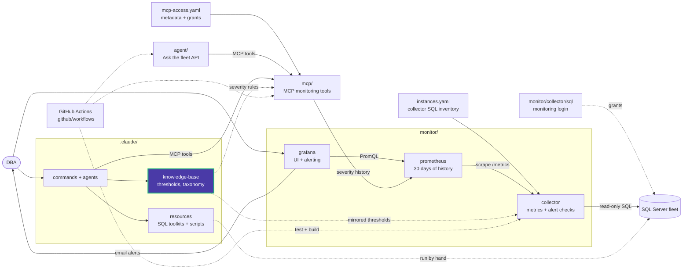

# Knowledge Base

Two tiers, different jobs — don't confuse them.

## `_static/` — compact, cross-cutting index

Five files, none of them narrative: `thresholds.yaml` (every severity number — memory, IO, index, waits, backup/CHECKDB/jobs, AG, query performance, storage), `taxonomy.md` (category → Grafana panel / alert check → script → tool name → source doc, one routing table shared by the `sql-server-dba` agent, `mcp/`'s tools, and the collector's alert checks), `naming-conventions.md` (the SQL naming standard, mirrored from `CLAUDE.md`), `methodology.md` (a 10-step index pointing into `.claude/resources/performance/README.md`), and `scripts-index.md` (read-only/write status and MCP-wrapping per script).

This tier exists so a number or a rule only has **one** place to change. Nothing in here is prose you'd hand a new DBA to read top to bottom — it's what an agent (or a slash command) reads at the moment it needs a specific threshold or routing decision, instead of carrying its own copy that can silently drift.

## `<database-name>.md` — deep per-instance data

Built by `/sql-kb <database>`: table volumes (SMALL/MEDIUM/HIGH/CRITICAL classification), existing index inventory with usage stats, missing-index hints from the DMVs, unused-index candidates, and the SQL Server version/edition capabilities that gate certain DDL (`ONLINE = ON`, `RESUMABLE`, IQP features). Consumed by `/sql-pr-review` to assess risk against real table sizes, not guesses.

Different axis from `_static/`: this is per-database and time-sensitive (row counts go stale), where `_static/` is cross-cutting and changes only when the toolkit's own rules change. None of these files exist yet in this repo — `/sql-kb` hasn't been run against a real database here.

## Where the narrative lives

Neither tier explains *why* a threshold is what it is, or walks through *how* to actually run a tuning pass — that's `.claude/resources/performance/README.md` (10-step methodology, full walkthrough), `.claude/resources/maintenance/README.md` (Ola Hallengren setup, scheduling, use cases), and `.claude/resources/sql-scripts/README.md` (the 18-topic script library), written for a human reading them, same depth and detail as before — they moved under `.claude/resources/` alongside the rest of this toolkit's Claude Code tooling, they didn't get thinner. `_static/` cites those files as its source; it doesn't replace them. If you're onboarding a new DBA to this toolkit, start there — come back here only when you need the compact, machine-checkable version of the same rules.

<!-- project-map:start -->
## Where this fits

- `_static/thresholds.yaml` is the single source of severity numbers. The collector's `catalog.py` mirrors its `alerts:` section; MCP's `queries.py` uses its diagnostic thresholds.
- `_static/taxonomy.md` routes each category to its Grafana panel, alert check, script and MCP tool.
- Read by the slash commands and agents; per-database files are written by `/sql-kb`.



The highlighted box is this folder. Solid arrows are runtime calls; dotted arrows are configuration, mirrored rules, or manual use.

### In the repository

```text
data-eyes/
├── .claude/                                  Claude Code toolkit
│   ├── agents/                               sql-server-dba, dashboard-app
│   ├── commands/                             12 slash commands
│   ├── knowledge-base/                       Static KB + per-database KBs  ◀ you are here
│   │   └── _static/                          Thresholds, taxonomy, naming, methodology
│   └── resources/                            SQL toolkits and script library
├── .github/                                  GitHub configuration
├── agent/                                    "Ask the fleet" API
├── assets/                                   Logo
├── mcp/                                      MCP monitoring tools
├── monitor/                                  Collector -> Prometheus -> Grafana
├── .env.example                              Template for .env (Grafana, agent)
├── .mcp.json                                 Claude Code MCP registration (stdio, dev)
├── CLAUDE.md                                 Project instructions for Claude Code
├── README.md                                 Setup, configuration, security
├── docker-compose.yml                        The whole stack
└── instances.example.yaml                    Template for collector SQL inventory
```
<!-- project-map:end -->
