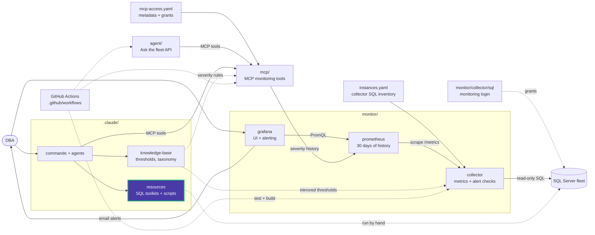

# .claude/resources

SQL Server reference material used by the agents and slash commands, and readable on
its own.

| Folder | Contents | Read-only? |
|---|---|---|
| [performance/](performance/) | 10-step tuning methodology, 4 diagnostic queries plus 5 structured (`.json.sql`) variants, tuning workbook | Yes |
| [maintenance/](maintenance/) | Ola Hallengren playbooks, SQL Agent schedules, 3 use-case files, 7 live diagnostics | Diagnostics only |
| [sql-scripts/](sql-scripts/) | 84 scripts in 18 topic folders | Mixed, see each folder |

## Which folder to use

- **Is it healthy right now?** `maintenance/diagnostics/` or `performance/additional_queries/`.
  Each has an MCP tool that runs the same check live.
- **How do I tune this?** `performance/README.md`.
- **Set up backups, CHECKDB, index jobs:** `maintenance/`.
- **A one-off DBA task** (permissions, Query Store, SSRS, shrink, ...): `sql-scripts/`,
  routed by `/sql-scripts`.

Thresholds behind every severity are in
[thresholds.yaml](../knowledge-base/_static/thresholds.yaml), not in these files.

<!-- project-map:start -->
## Where this fits

- Read by `/sql-performance`, `/sql-maintenance`, `/sql-scripts` and the `sql-server-dba` agent.
- The diagnostics in `maintenance/diagnostics/` and `performance/additional_queries/` have twins in MCP's `queries.py`, which is what runs live.
- Nothing here runs on its own. A DBA, `/sql-scripts` or the `sql-server-dba` agent picks a script and runs it against a server in the fleet.



The highlighted box is this folder. Solid arrows are runtime calls; dotted arrows are configuration, mirrored rules, or manual use.

### In the repository

```text
data-eyes/
├── .claude/                                  Claude Code toolkit
│   ├── agents/                               sql-server-dba, dashboard-app
│   ├── commands/                             12 slash commands
│   ├── knowledge-base/                       Static KB + per-database KBs
│   └── resources/                            SQL toolkits and script library  ◀ you are here
│       ├── maintenance/                      Ola Hallengren playbooks and schedules
│       ├── performance/                      10-step tuning methodology, workbook
│       └── sql-scripts/                      84 scripts in 18 topics
├── .github/                                  GitHub configuration
├── agent/                                    "Ask the fleet" API
├── assets/                                   Logo
├── mcp/                                      MCP monitoring tools
├── monitor/                                  Collector -> Prometheus -> Grafana
├── .env.example                              Template for .env (Grafana, agent)
├── .mcp.json                                 Claude Code MCP registration (stdio, dev)
├── CLAUDE.md                                 Project instructions for Claude Code
├── README.md                                 Setup, configuration, security
├── docker-compose.yml                        The whole stack
└── instances.example.yaml                    Template for collector SQL inventory
```
<!-- project-map:end -->
