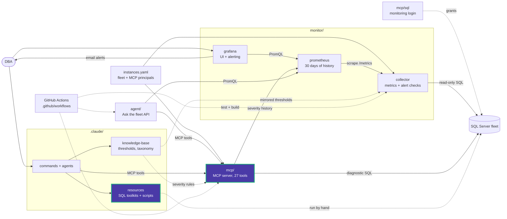

# maintenance/diagnostics

Live "is it healthy right now?" queries. Every script is read-only and returns rows
with a `severity` (OK, WARNING, CRITICAL). Each one has an MCP tool that runs the same
check, so prefer the tool when an MCP server is reachable.

| Script | Checks | MCP tool | Docs |
|---|---|---|---|
| [backup_health_check.sql](backup_health_check.sql) | Last FULL, DIFF and LOG backup per database, by age | `backup_health` | [docs](docs/backup_health_check.md) |
| [checkdb_staleness.sql](checkdb_staleness.sql) | Last clean CHECKDB and rows in `suspect_pages` | `checkdb_health` | [docs](docs/checkdb_staleness.md) |
| [fragmentation_live_scan.sql](fragmentation_live_scan.sql) | Live `dm_db_index_physical_stats` scan. Expensive on large databases | `index_fragmentation` | [docs](docs/fragmentation_live_scan.md) |
| [blocking_chain_snapshot.sql](blocking_chain_snapshot.sql) | Active blocking with head-blocker identification | `blocking_snapshot` | [docs](docs/blocking_chain_snapshot.md) |
| [ag_sync_health.sql](ag_sync_health.sql) | Per-database AG synchronization health and queues | `ag_health` | [docs](docs/ag_sync_health.md) |
| [job_failure_scan.sql](job_failure_scan.sql) | Last run outcome and failure count per enabled Agent job | `job_health` | [docs](docs/job_failure_scan.md) |
| [db_space_check.sql](db_space_check.sql) | Per-file size and free space plus drive free space | `db_space` | [docs](docs/db_space_check.md) |

Severity numbers come from the `maintenance.*` keys in
[thresholds.yaml](../../../knowledge-base/_static/thresholds.yaml). The rest of
`maintenance/` is action scripts that change the server.

<!-- project-map:start -->
## Where this fits

- Each script is the copy-paste twin of an MCP tool (`backup_health`, `checkdb_health`, `index_fragmentation`, `blocking_snapshot`, `ag_health`, `job_health`, `db_space`). The MCP version in `mcp/src/data_eyes_mcp/queries.py` is what runs live.
- Severities use the `maintenance.*` thresholds in `knowledge-base/_static/thresholds.yaml`.
- The collector's alert checks watch the same areas continuously, and Grafana alerts on them.



The highlighted box is this folder. Solid arrows are runtime calls; dotted arrows are configuration, mirrored rules, or manual use.

### In the repository

```text
data-eyes/
├── .claude/                                  Claude Code toolkit
│   ├── agents/                               sql-server-dba, dashboard-app
│   ├── commands/                             12 slash commands
│   ├── knowledge-base/                       Static KB + per-database KBs
│   └── resources/                            SQL toolkits and script library
│       ├── maintenance/                      Ola Hallengren playbooks and schedules
│       │   ├── diagnostics/                  7 live health queries  ◀ you are here
│       │   │   └── docs/                     One guide per diagnostic
│       │   └── use_cases/                    Ola Hallengren examples
│       ├── performance/                      10-step tuning methodology, workbook
│       └── sql-scripts/                      84 scripts in 18 topics
├── .github/                                  GitHub configuration
├── agent/                                    "Ask the fleet" API
├── assets/                                   Logo
├── mcp/                                      MCP server (27 read-only tools)
├── monitor/                                  Collector -> Prometheus -> Grafana
├── .env.example                              Template for .env (Grafana, agent)
├── .mcp.json                                 Claude Code MCP registration (stdio, dev)
├── CLAUDE.md                                 Project instructions for Claude Code
├── README.md                                 Setup, configuration, security
├── docker-compose.yml                        The whole stack
└── instances.example.yaml                    Template for instances.yaml (fleet, MCP principals)
```
<!-- project-map:end -->
