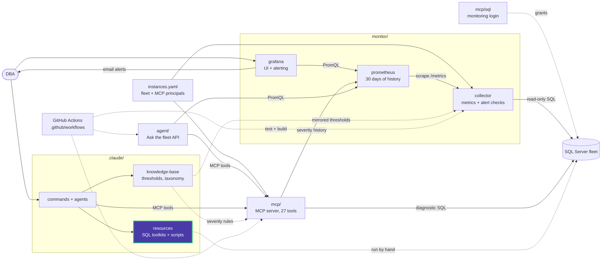

# maintenance/diagnostics/docs

One guide per diagnostic script: what it checks, its output columns, how severity is
decided, and how to read the result.

| Guide | Script |
|---|---|
| [ag_sync_health.md](ag_sync_health.md) | [ag_sync_health.sql](../ag_sync_health.sql) |
| [backup_health_check.md](backup_health_check.md) | [backup_health_check.sql](../backup_health_check.sql) |
| [blocking_chain_snapshot.md](blocking_chain_snapshot.md) | [blocking_chain_snapshot.sql](../blocking_chain_snapshot.sql) |
| [checkdb_staleness.md](checkdb_staleness.md) | [checkdb_staleness.sql](../checkdb_staleness.sql) |
| [db_space_check.md](db_space_check.md) | [db_space_check.sql](../db_space_check.sql) |
| [fragmentation_live_scan.md](fragmentation_live_scan.md) | [fragmentation_live_scan.sql](../fragmentation_live_scan.sql) |
| [job_failure_scan.md](job_failure_scan.md) | [job_failure_scan.sql](../job_failure_scan.sql) |

When you change a script's logic, update its guide and the matching query in
`mcp/src/data_eyes_mcp/queries.py`.

<!-- project-map:start -->
## Where this fits

- Explains the output of each diagnostic: the same columns and severities the matching MCP tool returns.
- Read by DBAs, and by agents when they interpret a tool result.



The highlighted box is this folder. Solid arrows are runtime calls; dotted arrows are configuration, mirrored rules, or manual use.

### In the repository

```text
data-eyes/
├── .claude/                                  Claude Code toolkit
│   ├── agents/                               sql-server-dba, dashboard-app
│   ├── commands/                             12 slash commands
│   ├── knowledge-base/                       Static KB + per-database KBs
│   └── resources/                            SQL toolkits and script library
│       ├── maintenance/                      Ola Hallengren playbooks and schedules
│       │   ├── diagnostics/                  7 live health queries
│       │   │   └── docs/                     One guide per diagnostic  ◀ you are here
│       │   └── use_cases/                    Ola Hallengren examples
│       ├── performance/                      10-step tuning methodology, workbook
│       └── sql-scripts/                      84 scripts in 18 topics
├── .github/                                  GitHub configuration
├── agent/                                    "Ask the fleet" API
├── assets/                                   Logo
├── mcp/                                      MCP server (27 read-only tools)
├── monitor/                                  Collector -> Prometheus -> Grafana
├── .env.example                              Template for .env (Grafana, agent)
├── .mcp.json                                 Claude Code MCP registration (stdio, dev)
├── CLAUDE.md                                 Project instructions for Claude Code
├── README.md                                 Setup, configuration, security
├── docker-compose.yml                        The whole stack
└── instances.example.yaml                    Template for instances.yaml (fleet, MCP principals)
```
<!-- project-map:end -->
