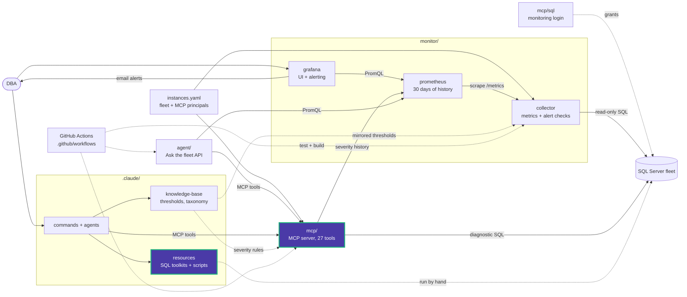

# performance/additional_queries

Read-only diagnostic queries for the performance methodology. Most come in two forms:

- **`.sql`**: the copy-paste form for SSMS.
- **`.json.sql`**: the same analysis with a `severity` column and `FOR JSON AUTO`
  output, matching what the MCP tool returns.

| Analysis | Plain | Structured | MCP tool | Docs |
|---|---|---|---|---|
| Missing indexes (top 25 by impact) | [missing_indexes.sql](missing_indexes.sql) | [missing_indexes.json.sql](missing_indexes.json.sql) | `missing_indexes` | [docs](docs/missing_indexes.md) |
| Unused nonclustered indexes (top 25) | [unused_indexes.sql](unused_indexes.sql) | [unused_indexes.json.sql](unused_indexes.json.sql) | `unused_indexes` | [docs](docs/unused_indexes.md) |
| Wait statistics | [wait_statistics.sql](wait_statistics.sql) | [wait_statistics.json.sql](wait_statistics.json.sql) | `wait_stats` | [docs](docs/wait_statistics.md) |
| Stale statistics | [update_statistics.sql](update_statistics.sql) | [update_statistics.json.sql](update_statistics.json.sql) | `stale_statistics` | [docs](docs/update_statistics.md) |
| Top queries by average duration | — | [top_queries.json.sql](top_queries.json.sql) | `top_queries` | [docs](docs/top_queries.md) |

## Before acting on results

- Missing-index hints are suggestions. Check for overlapping indexes before you
  create one.
- Measure the impact before you drop an unused index. Usage stats reset when the
  instance restarts.
- `update_statistics.sql` also contains `sp_updatestats` and `UPDATE STATISTICS`
  examples, which change the server. Run only the analysis part unless you have
  confirmed the update.

Severity numbers come from [thresholds.yaml](../../../knowledge-base/_static/thresholds.yaml).

<!-- project-map:start -->
## Where this fits

- Each analysis is the copy-paste twin of an MCP tool (`missing_indexes`, `unused_indexes`, `wait_stats`, `stale_statistics`, `top_queries`). The `.json.sql` form matches what the tool returns.
- Severities use `knowledge-base/_static/thresholds.yaml`.
- Steps 1 and 2 of the methodology in `performance/README.md` run these.



The highlighted box is this folder. Solid arrows are runtime calls; dotted arrows are configuration, mirrored rules, or manual use.

### In the repository

```text
data-eyes/
├── .claude/                                  Claude Code toolkit
│   ├── agents/                               sql-server-dba, dashboard-app
│   ├── commands/                             12 slash commands
│   ├── knowledge-base/                       Static KB + per-database KBs
│   └── resources/                            SQL toolkits and script library
│       ├── maintenance/                      Ola Hallengren playbooks and schedules
│       ├── performance/                      10-step tuning methodology, workbook
│       │   └── additional_queries/           Diagnostic queries (+ .json.sql)  ◀ you are here
│       │       └── docs/                     One guide per query
│       └── sql-scripts/                      84 scripts in 18 topics
├── .github/                                  GitHub configuration
├── agent/                                    "Ask the fleet" API
├── assets/                                   Logo
├── mcp/                                      MCP server (27 read-only tools)
├── monitor/                                  Collector -> Prometheus -> Grafana
├── .env.example                              Template for .env (Grafana, agent)
├── .mcp.json                                 Claude Code MCP registration (stdio, dev)
├── CLAUDE.md                                 Project instructions for Claude Code
├── README.md                                 Setup, configuration, security
├── docker-compose.yml                        The whole stack
└── instances.example.yaml                    Template for instances.yaml (fleet, MCP principals)
```
<!-- project-map:end -->
