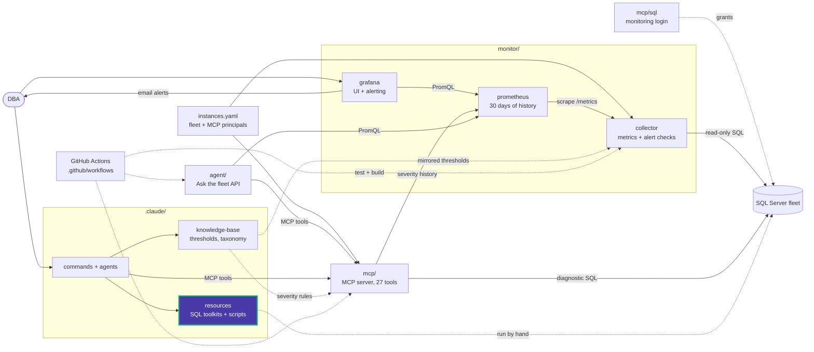

# performance/additional_queries/docs

One guide per analysis: purpose, output columns, features, warnings, thresholds and
how to interpret the result.

| Guide | Scripts |
|---|---|
| [missing_indexes.md](missing_indexes.md) | `missing_indexes.sql`, `missing_indexes.json.sql` |
| [unused_indexes.md](unused_indexes.md) | `unused_indexes.sql`, `unused_indexes.json.sql` |
| [wait_statistics.md](wait_statistics.md) | `wait_statistics.sql`, `wait_statistics.json.sql` |
| [update_statistics.md](update_statistics.md) | `update_statistics.sql`, `update_statistics.json.sql` |
| [top_queries.md](top_queries.md) | `top_queries.json.sql` |

For where each analysis fits in the 10-step methodology, see the
[performance README](../../README.md#performance-tuning-methodology).

<!-- project-map:start -->
## Where this fits

- Explains the output of each query: the same columns and severities the matching MCP tool returns.
- Read by DBAs, and by agents when they interpret a tool result.



The highlighted box is this folder. Solid arrows are runtime calls; dotted arrows are configuration, mirrored rules, or manual use.

### In the repository

```text
data-eyes/
├── .claude/                                  Claude Code toolkit
│   ├── agents/                               sql-server-dba, dashboard-app
│   ├── commands/                             12 slash commands
│   ├── knowledge-base/                       Static KB + per-database KBs
│   └── resources/                            SQL toolkits and script library
│       ├── maintenance/                      Ola Hallengren playbooks and schedules
│       ├── performance/                      10-step tuning methodology, workbook
│       │   └── additional_queries/           Diagnostic queries (+ .json.sql)
│       │       └── docs/                     One guide per query  ◀ you are here
│       └── sql-scripts/                      84 scripts in 18 topics
├── .github/                                  GitHub configuration
├── agent/                                    "Ask the fleet" API
├── assets/                                   Logo
├── mcp/                                      MCP server (27 read-only tools)
├── monitor/                                  Collector -> Prometheus -> Grafana
├── .env.example                              Template for .env (Grafana, agent)
├── .mcp.json                                 Claude Code MCP registration (stdio, dev)
├── CLAUDE.md                                 Project instructions for Claude Code
├── README.md                                 Setup, configuration, security
├── docker-compose.yml                        The whole stack
└── instances.example.yaml                    Template for instances.yaml (fleet, MCP principals)
```
<!-- project-map:end -->
