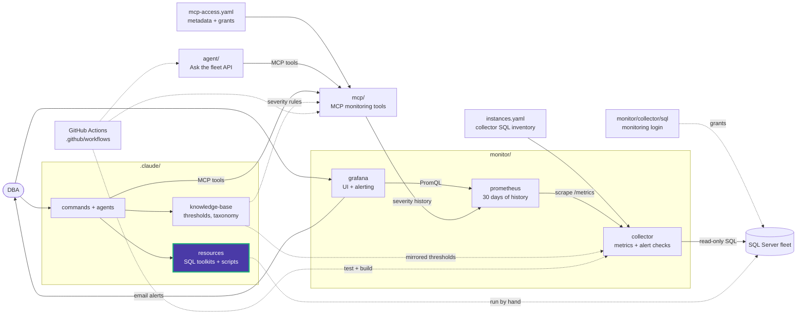

# SQL Scripts

This is where I save all my SQL Server scripts — a personal collection of reusable queries, utilities, and configurations organized by topic.

> Agent/machine-facing routing: the [`/sql-scripts` command](../../commands/sql-scripts.md) owns the keyword-to-subfolder routing table — this repository's own folder list below is kept in sync with it, not the other way around.

### Repository Structure
| Folder | Purpose |
|--------|---------|
| [audit](./audit/) | Scripts and queries for auditing SQL Server activities |
| [backup_recovery](./backup_recovery/) | Backup and recovery scripts for databases |
| [custom_alert_emails](./custom_alert_emails/) | Custom alert email implementations |
| [database_size](./database_size/) | Queries to monitor database size |
| [free_space](./free_space/) | Queries to monitor disk and file free space |
| [functions](./functions/) | Custom SQL functions |
| [helps](./helps/) | Helper scripts and templates |
| [index](./index/) | Index management scripts |
| [lock](./lock/) | Scripts for monitoring and resolving locks |
| [query_store](./query_store/) | Query Store enabling and analysis scripts |
| [server](./server/) | Server-related configuration scripts |
| [sql_access](./sql_access/) | Scripts for SQL Server user and permission management |
| [sql_agent](./sql_agent/) | SQL Server Agent job scripts |
| [sql_docker](./sql_docker/) | Docker Compose setup for SQL Server |
| [sql_profiler](./sql_profiler/) | SQL Profiler scripts and traces |
| [ssis](./ssis/) | SSIS package examples |
| [ssrs](./ssrs/) | SSRS report scripts |
| [triggers](./triggers/) | Database triggers |

<!-- project-map:start -->
## Where this fits

- Routed by the `/sql-scripts` command, which owns the keyword-to-folder table.
- No script here is wrapped by an MCP tool. A recurring live diagnostic should be promoted to `maintenance/diagnostics/` or `performance/additional_queries/` with a matching tool.
- Nothing here runs on its own. A DBA, `/sql-scripts` or the `sql-server-dba` agent picks a script and runs it against a server in the fleet.



The highlighted box is this folder. Solid arrows are runtime calls; dotted arrows are configuration, mirrored rules, or manual use.

### In the repository

```text
data-eyes/
├── .claude/                                  Claude Code toolkit
│   ├── agents/                               sql-server-dba, dashboard-app
│   ├── commands/                             12 slash commands
│   ├── knowledge-base/                       Static KB + per-database KBs
│   └── resources/                            SQL toolkits and script library
│       ├── maintenance/                      Ola Hallengren playbooks and schedules
│       ├── performance/                      10-step tuning methodology, workbook
│       └── sql-scripts/                      84 scripts in 18 topics  ◀ you are here
│           ├── audit/                        SQL Server Audit
│           ├── backup_recovery/              Backups, restores, recovery models
│           ├── custom_alert_emails/          Database Mail job emails
│           ├── database_size/                Database, file and table sizes
│           ├── free_space/                   Reclaiming space, shrink
│           ├── functions/                    Custom functions
│           ├── helps/                        Helpers and templates
│           ├── index/                        Create, rebuild, inspect indexes
│           ├── lock/                         Sessions and blocking
│           ├── query_store/                  Query Store analysis
│           ├── server/                       Instance info, linked servers
│           ├── sql_access/                   Logins, users, permissions
│           ├── sql_agent/                    Agent jobs and sessions
│           ├── sql_docker/                   Local SQL Server 2022
│           ├── sql_profiler/                 Server-side traces
│           ├── ssis/                         SSIS jobs and SSISDB
│           ├── ssrs/                         ReportServer queries
│           └── triggers/                     Trigger examples
├── .github/                                  GitHub configuration
├── agent/                                    "Ask the fleet" API
├── assets/                                   Logo
├── mcp/                                      MCP monitoring tools
├── monitor/                                  Collector -> Prometheus -> Grafana
├── .env.example                              Template for .env (Grafana, agent)
├── .mcp.json                                 Claude Code MCP registration (stdio, dev)
├── CLAUDE.md                                 Project instructions for Claude Code
├── README.md                                 Setup, configuration, security
├── docker-compose.yml                        The whole stack
└── instances.example.yaml                    Template for collector SQL inventory
```
<!-- project-map:end -->
