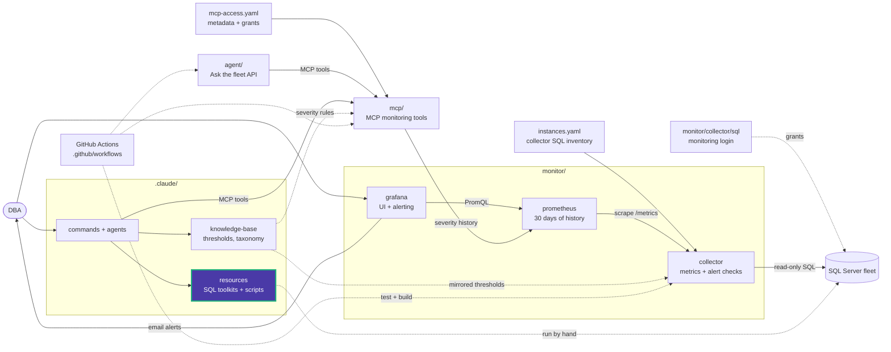

# audit

SQL Server Audit setup for compliance and security monitoring.

| Script | What it does | Changes the server |
|---|---|---|
| [audit_toolkit.sql](audit_toolkit.sql) | Creates a server audit, a server audit specification and a database audit specification, then shows how to read the audit log | Yes |
| [audit_users_table.sql](audit_users_table.sql) | Audits INSERT, UPDATE and DELETE on a `users` table, with a test and a query to read the results | Yes |

Both create audit objects and write audit files to disk. Set the file path and target
database, and confirm before running. Reading the audit log afterwards is read-only.

<!-- project-map:start -->
## Where this fits

- Part of the script library under `.claude/resources/sql-scripts/`, routed by the `/sql-scripts` command.
- Nothing here runs on its own. A DBA, `/sql-scripts` or the `sql-server-dba` agent picks a script and runs it against a server in the fleet.
- Data Eyes does not collect audit events. The collector's `sysadmin_changed`, `login_created` and `sa_enabled` checks cover the security changes it watches.



The highlighted box is this folder. Solid arrows are runtime calls; dotted arrows are configuration, mirrored rules, or manual use.

### In the repository

```text
data-eyes/
├── .claude/                                  Claude Code toolkit
│   ├── agents/                               sql-server-dba, dashboard-app
│   ├── commands/                             12 slash commands
│   ├── knowledge-base/                       Static KB + per-database KBs
│   └── resources/                            SQL toolkits and script library
│       ├── maintenance/                      Ola Hallengren playbooks and schedules
│       ├── performance/                      10-step tuning methodology, workbook
│       └── sql-scripts/                      84 scripts in 18 topics
│           ├── audit/                        SQL Server Audit  ◀ you are here
│           ├── backup_recovery/              Backups, restores, recovery models
│           ├── custom_alert_emails/          Database Mail job emails
│           ├── database_size/                Database, file and table sizes
│           ├── free_space/                   Reclaiming space, shrink
│           ├── functions/                    Custom functions
│           ├── helps/                        Helpers and templates
│           ├── index/                        Create, rebuild, inspect indexes
│           ├── lock/                         Sessions and blocking
│           ├── query_store/                  Query Store analysis
│           ├── server/                       Instance info, linked servers
│           ├── sql_access/                   Logins, users, permissions
│           ├── sql_agent/                    Agent jobs and sessions
│           ├── sql_docker/                   Local SQL Server 2022
│           ├── sql_profiler/                 Server-side traces
│           ├── ssis/                         SSIS jobs and SSISDB
│           ├── ssrs/                         ReportServer queries
│           └── triggers/                     Trigger examples
├── .github/                                  GitHub configuration
├── agent/                                    "Ask the fleet" API
├── assets/                                   Logo
├── mcp/                                      MCP monitoring tools
├── monitor/                                  Collector -> Prometheus -> Grafana
├── .env.example                              Template for .env (Grafana, agent)
├── .mcp.json                                 Claude Code MCP registration (stdio, dev)
├── CLAUDE.md                                 Project instructions for Claude Code
├── README.md                                 Setup, configuration, security
├── docker-compose.yml                        The whole stack
└── instances.example.yaml                    Template for collector SQL inventory
```
<!-- project-map:end -->
