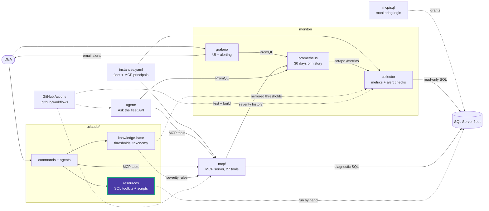

# database_size

Database, file and table sizes.

| Script | What it does | Changes the server |
|---|---|---|
| [database_files_detail.sql](database_files_detail.sql) | Logical and physical file names, type and size per database | No |
| [database_storage_breakdown.sql](database_storage_breakdown.sql) | Data, log and total size per database | No |
| [total_used_storage.sql](total_used_storage.sql) | Total storage allocated across all databases | No |
| [largest_table.sql](largest_table.sql) | Tables by total, used and data size, with row counts | No |
| [sp_spaceused.sql](sp_spaceused.sql) | Database size summary and unallocated space | No |
| [database_storage_alert.sql](database_storage_alert.sql) | Compares used size with max size and raises warning to emergency messages | No (raises errors only) |
| [memory_settings.sql](memory_settings.sql) | Shows and sets `max server memory` | Yes, the `sp_configure` part |

For live space checks with severity, use the `db_space` MCP tool. The
`memory_settings.sql` change takes effect immediately; choose the value from the
server's RAM before running it.

<!-- project-map:start -->
## Where this fits

- Part of the script library under `.claude/resources/sql-scripts/`, routed by the `/sql-scripts` command.
- Nothing here runs on its own. A DBA, `/sql-scripts` or the `sql-server-dba` agent picks a script and runs it against a server in the fleet.
- The collector's `databases` metric group, the `database_growth` and `maxsize_growth` checks, and the `db_space` MCP tool track the same numbers.



The highlighted box is this folder. Solid arrows are runtime calls; dotted arrows are configuration, mirrored rules, or manual use.

### In the repository

```text
data-eyes/
├── .claude/                                  Claude Code toolkit
│   ├── agents/                               sql-server-dba, dashboard-app
│   ├── commands/                             12 slash commands
│   ├── knowledge-base/                       Static KB + per-database KBs
│   └── resources/                            SQL toolkits and script library
│       ├── maintenance/                      Ola Hallengren playbooks and schedules
│       ├── performance/                      10-step tuning methodology, workbook
│       └── sql-scripts/                      84 scripts in 18 topics
│           ├── audit/                        SQL Server Audit
│           ├── backup_recovery/              Backups, restores, recovery models
│           ├── custom_alert_emails/          Database Mail job emails
│           ├── database_size/                Database, file and table sizes  ◀ you are here
│           ├── free_space/                   Reclaiming space, shrink
│           ├── functions/                    Custom functions
│           ├── helps/                        Helpers and templates
│           ├── index/                        Create, rebuild, inspect indexes
│           ├── lock/                         Sessions and blocking
│           ├── query_store/                  Query Store analysis
│           ├── server/                       Instance info, linked servers
│           ├── sql_access/                   Logins, users, permissions
│           ├── sql_agent/                    Agent jobs and sessions
│           ├── sql_docker/                   Local SQL Server 2022
│           ├── sql_profiler/                 Server-side traces
│           ├── ssis/                         SSIS jobs and SSISDB
│           ├── ssrs/                         ReportServer queries
│           └── triggers/                     Trigger examples
├── .github/                                  GitHub configuration
├── agent/                                    "Ask the fleet" API
├── assets/                                   Logo
├── mcp/                                      MCP server (27 read-only tools)
├── monitor/                                  Collector -> Prometheus -> Grafana
├── .env.example                              Template for .env (Grafana, agent)
├── .mcp.json                                 Claude Code MCP registration (stdio, dev)
├── CLAUDE.md                                 Project instructions for Claude Code
├── README.md                                 Setup, configuration, security
├── docker-compose.yml                        The whole stack
└── instances.example.yaml                    Template for instances.yaml (fleet, MCP principals)
```
<!-- project-map:end -->
