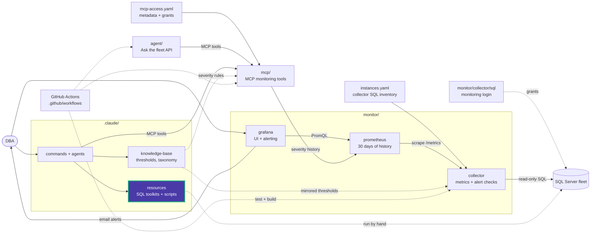

# sql_access

Logins, users, roles and permissions.

| Script | What it does | Changes the server |
|---|---|---|
| [users_info.sql](users_info.sql) | Server logins and last login time, read from the error logs | No (temp tables only) |
| [who_is_trying_access.sql](who_is_trying_access.sql) | Failed login attempts from the error logs, with counts and first and last times | No (temp tables only) |
| [role_and_login.sql](role_and_login.sql) | Creates a login, a database user and a role, and grants schema permissions | Yes |
| [grant_statements_access.sql](grant_statements_access.sql) | Creates a user if missing and grants SELECT, INSERT, UPDATE, DELETE on a schema | Yes |
| [grant_view_access.sql](grant_view_access.sql) | Grants database access and changes the database owner | Yes |
| [deny_view_access.sql](deny_view_access.sql) | Denies `VIEW ANY DATABASE` and changes the database owner | Yes |
| [drop_user.sql](drop_user.sql) | Revokes `CONNECT` and drops a database user | Yes |

Grant the least privilege that works. For the Data Eyes monitoring login itself, use
[monitor/collector/sql/](../../../../monitor/collector/sql/) instead.

<!-- project-map:start -->
## Where this fits

- Part of the script library under `.claude/resources/sql-scripts/`, routed by the `/sql-scripts` command.
- Nothing here runs on its own. A DBA, `/sql-scripts` or the `sql-server-dba` agent picks a script and runs it against a server in the fleet.
- For the Data Eyes monitoring login, use `monitor/collector/sql/`. The collector's `sysadmin_changed`, `login_created` and `login_failed` checks watch these changes.



The highlighted box is this folder. Solid arrows are runtime calls; dotted arrows are configuration, mirrored rules, or manual use.

### In the repository

```text
data-eyes/
├── .claude/                                  Claude Code toolkit
│   ├── agents/                               sql-server-dba, dashboard-app
│   ├── commands/                             12 slash commands
│   ├── knowledge-base/                       Static KB + per-database KBs
│   └── resources/                            SQL toolkits and script library
│       ├── maintenance/                      Ola Hallengren playbooks and schedules
│       ├── performance/                      10-step tuning methodology, workbook
│       └── sql-scripts/                      84 scripts in 18 topics
│           ├── audit/                        SQL Server Audit
│           ├── backup_recovery/              Backups, restores, recovery models
│           ├── custom_alert_emails/          Database Mail job emails
│           ├── database_size/                Database, file and table sizes
│           ├── free_space/                   Reclaiming space, shrink
│           ├── functions/                    Custom functions
│           ├── helps/                        Helpers and templates
│           ├── index/                        Create, rebuild, inspect indexes
│           ├── lock/                         Sessions and blocking
│           ├── query_store/                  Query Store analysis
│           ├── server/                       Instance info, linked servers
│           ├── sql_access/                   Logins, users, permissions  ◀ you are here
│           ├── sql_agent/                    Agent jobs and sessions
│           ├── sql_docker/                   Local SQL Server 2022
│           ├── sql_profiler/                 Server-side traces
│           ├── ssis/                         SSIS jobs and SSISDB
│           ├── ssrs/                         ReportServer queries
│           └── triggers/                     Trigger examples
├── .github/                                  GitHub configuration
├── agent/                                    "Ask the fleet" API
├── assets/                                   Logo
├── mcp/                                      MCP monitoring tools
├── monitor/                                  Collector -> Prometheus -> Grafana
├── .env.example                              Template for .env (Grafana, agent)
├── .mcp.json                                 Claude Code MCP registration (stdio, dev)
├── CLAUDE.md                                 Project instructions for Claude Code
├── README.md                                 Setup, configuration, security
├── docker-compose.yml                        The whole stack
└── instances.example.yaml                    Template for collector SQL inventory
```
<!-- project-map:end -->
