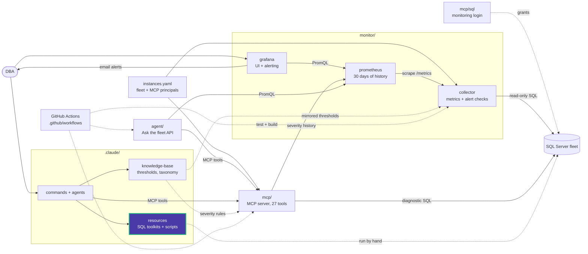

# sql_agent

SQL Server Agent jobs and sessions.

| Script | What it does | Changes the server |
|---|---|---|
| [monitor_currently_agent_jobs.sql](monitor_currently_agent_jobs.sql) | Jobs running now, with start time and current step | No |
| [check_running_and_stop_jobs.sql](check_running_and_stop_jobs.sql) | Running jobs with their session and SQL text, plus `sp_stop_job` examples | Yes, the stop part |
| [sql_agent_sessions.sql](sql_agent_sessions.sql) | Sessions opened by SQL Agent, plus a `KILL` template | Yes, the `KILL` part |
| [purge_job_history.sql](purge_job_history.sql) | Deletes job history older than 30 days (`sp_purge_jobhistory`) | Yes |
| [grant_access.sql](grant_access.sql) | Adds a user to the `SQLAgentUserRole`, `SQLAgentReaderRole` or `SQLAgentOperatorRole` roles in `msdb` | Yes |

Stopping a job or killing its session can leave work half done and roll back a long
transaction. Check what the job is doing first. For job failure health across the
fleet, use the `job_health` MCP tool.

<!-- project-map:start -->
## Where this fits

- Part of the script library under `.claude/resources/sql-scripts/`, routed by the `/sql-scripts` command.
- Nothing here runs on its own. A DBA, `/sql-scripts` or the `sql-server-dba` agent picks a script and runs it against a server in the fleet.
- The collector's `job_failed`, `job_disabled_or_deleted` and `agent_service_stopped` checks and the `job_health` MCP tool watch Agent jobs.



The highlighted box is this folder. Solid arrows are runtime calls; dotted arrows are configuration, mirrored rules, or manual use.

### In the repository

```text
data-eyes/
├── .claude/                                  Claude Code toolkit
│   ├── agents/                               sql-server-dba, dashboard-app
│   ├── commands/                             12 slash commands
│   ├── knowledge-base/                       Static KB + per-database KBs
│   └── resources/                            SQL toolkits and script library
│       ├── maintenance/                      Ola Hallengren playbooks and schedules
│       ├── performance/                      10-step tuning methodology, workbook
│       └── sql-scripts/                      84 scripts in 18 topics
│           ├── audit/                        SQL Server Audit
│           ├── backup_recovery/              Backups, restores, recovery models
│           ├── custom_alert_emails/          Database Mail job emails
│           ├── database_size/                Database, file and table sizes
│           ├── free_space/                   Reclaiming space, shrink
│           ├── functions/                    Custom functions
│           ├── helps/                        Helpers and templates
│           ├── index/                        Create, rebuild, inspect indexes
│           ├── lock/                         Sessions and blocking
│           ├── query_store/                  Query Store analysis
│           ├── server/                       Instance info, linked servers
│           ├── sql_access/                   Logins, users, permissions
│           ├── sql_agent/                    Agent jobs and sessions  ◀ you are here
│           ├── sql_docker/                   Local SQL Server 2022
│           ├── sql_profiler/                 Server-side traces
│           ├── ssis/                         SSIS jobs and SSISDB
│           ├── ssrs/                         ReportServer queries
│           └── triggers/                     Trigger examples
├── .github/                                  GitHub configuration
├── agent/                                    "Ask the fleet" API
├── assets/                                   Logo
├── mcp/                                      MCP server (27 read-only tools)
├── monitor/                                  Collector -> Prometheus -> Grafana
├── .env.example                              Template for .env (Grafana, agent)
├── .mcp.json                                 Claude Code MCP registration (stdio, dev)
├── CLAUDE.md                                 Project instructions for Claude Code
├── README.md                                 Setup, configuration, security
├── docker-compose.yml                        The whole stack
└── instances.example.yaml                    Template for instances.yaml (fleet, MCP principals)
```
<!-- project-map:end -->
