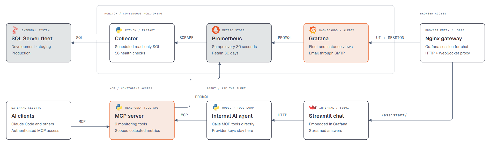
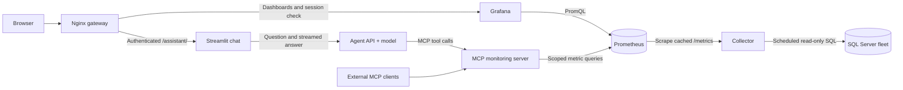

<div align="center">
  
</div>

# Data Eyes

Data Eyes is a SQL Server monitoring platform that combines health dashboards,
automated alerts, and an AI assistant to help you understand and troubleshoot your database fleet.

One scheduled collector reads SQL Server. Prometheus stores its measurements for
30 days. Grafana displays those measurements and sends alerts; the AI agent reads
them through MCP monitoring tools. Only the collector connects to SQL Server.

## Architecture



The request paths below describe the current runtime architecture. Arrows point
from the caller to the service it queries; results return along the same path.



The collector evaluates health checks independently of dashboard refreshes and chat
requests. Prometheus scrapes its cache every 30 seconds. Grafana and MCP see the same
collected measurements, including whether collection is fresh, stale, or unavailable.

For a chat question, Streamlit calls the agent API. The model chooses a monitoring
tool, the agent invokes it on MCP, and MCP checks permissions before querying
Prometheus. The agent streams progress and the answer back to the chat. It does not
query Prometheus directly. MCP has no SQL client, SQL credentials, or live SQL tools.

## Quick start

Requirements: Docker with Compose and network access from its containers to your
SQL Servers. Python 3.11+ and `uv` are needed for local development and helper scripts.
Run the following commands from the repository root unless stated otherwise.

1. **Create the local configuration files for a new installation.** Keep existing
   files when upgrading; the copy commands overwrite them.

   ```powershell
   Copy-Item .env.example .env
   Copy-Item instances.example.yaml instances.yaml
   Copy-Item mcp-access.example.yaml mcp-access.yaml
   ```

2. **Prepare a monitoring login on each SQL Server.** Review
   [provision-readonly-login.sql](monitor/collector/sql/provision-readonly-login.sql)
   before executing it with your server, login, password, database, and schema values.
   [provision-alerting-permissions.sql](monitor/collector/sql/provision-alerting-permissions.sql)
   documents optional grants for checks that read job history, maintenance logs, and
   other server metadata. Configure the resulting connection strings only in `instances.yaml`.
   Keep only the instances you intend to monitor. The hostname must resolve from Docker;
   `localhost` inside the collector refers to that container.

3. **Configure access and the UI.** Match instance names and environments in
   `mcp-access.yaml` to the collector inventory. Set `GF_SECURITY_ADMIN_PASSWORD`
   in `.env`. In [grafana.ini](monitor/grafana/grafana.ini), set `[server] root_url`
   to your browser-facing address: `http://localhost:3000` for local use or your HTTPS
   URL for deployment. The checked-in file currently names an existing deployment domain.

4. **Configure the assistant if you want chat.** Set the model provider, model, and
   credentials in `.env`. Generate a bearer token and its hash locally:

   ```powershell
   python -c "import secrets,hashlib; t=secrets.token_urlsafe(32); print('TOKEN='+t); print('SHA256='+hashlib.sha256(t.encode()).hexdigest())"
   ```

   Put the token in `.env` as `AGENT_MCP_TOKEN`, and its hash in
   `mcp-access.yaml` under `mcp_security.principals.ui-agent.token_sha256`.
   Grant that principal the tools and instances the assistant should access.
   Monitoring and dashboards work without a configured model; chat reports unavailable.

5. **Start the stack and open Grafana.**

   ```powershell
   docker compose up -d --build
   ```

   Open [localhost:3000](http://localhost:3000) and sign in using
   `GF_SECURITY_ADMIN_USER` / `GF_SECURITY_ADMIN_PASSWORD`. Fleet Overview is the
   home dashboard. Open [Ask the fleet](http://localhost:3000/d/ask-the-fleet/ask-the-fleet)
   for the embedded chat. SMTP configuration enables alert email delivery.

## Configuration

These three local files are ignored by Git. Keep credentials and token values out
of commits and shared logs; use the corresponding example files as templates.

| File | Contents | Read by |
|---|---|---|
| [instances.example.yaml](instances.example.yaml) -> `instances.yaml` | SQL fleet, environment labels, connection strings | Collector only |
| [mcp-access.example.yaml](mcp-access.example.yaml) -> `mcp-access.yaml` | Instance metadata, tool/instance grants, bearer-token hashes | MCP only |
| [.env.example](.env.example) -> `.env` | Grafana, SMTP, model settings, agent MCP token | Compose, which passes each service its settings |

### Fleet and MCP environments

The same instance name and environment must identify a server in both YAML files.
SQL credentials are rejected in MCP instance entries. Grafana discovers instances
from metric labels and does not read either inventory file.

Each MCP service restricts access using `DEPLOYMENT_ENVIRONMENT` and
`INSTANCE_ALLOWLIST` in [docker-compose.yml](docker-compose.yml), in addition to
principal grants. Defaults allow `dev`, `staging`, and `prod` in their respective
services. Update the allowlist when using other instance names; an empty allowlist
allows the configured instances in that service's environment, subject to grants.

The default stack starts the development MCP server. Enable the others with:

```powershell
docker compose --profile staging --profile production up -d --build
```

Profiles control MCP services, not collection: the collector monitors the inventory
in `instances.yaml` regardless of which MCP environments are running.

For installations migrating from the old combined inventory/security file:

```powershell
uv run --project mcp python scripts/migrate_monitoring_access.py
```

The migration preserves instance grants and token hashes, grants the new monitoring
tool catalog to existing tool users, and leaves the source unchanged. It refuses to
overwrite an existing policy. Review previously narrow tool grants after migration.

### Service settings

| Purpose | Variables |
|---|---|
| Grafana | `GRAFANA_BIND_IP` (default `127.0.0.1`), `GF_SECURITY_ADMIN_USER`, `GF_SECURITY_ADMIN_PASSWORD` |
| Alert email | `GRAFANA_NOTIFICATION_ADDRESSES`, `GRAFANA_SMTP_HOST`, `GRAFANA_SMTP_USER`, `GRAFANA_SMTP_PASSWORD`, `GRAFANA_SMTP_FROM_ADDRESS`, `GRAFANA_SMTP_FROM_NAME` |
| Model | `AI_PROVIDER` (`anthropic`, `openai`, `local`), `AI_MODEL`, provider-specific key and endpoint |
| Provider credentials/endpoints | `ANTHROPIC_API_KEY`, `OPENAI_API_KEY`, `OPENAI_BASE_URL`, `LOCAL_AI_BASE_URL`, optional `LOCAL_AI_API_KEY` |
| Agent monitoring access | `AGENT_MCP_TOKEN`, optional `AGENT_MCP_SERVERS` |

Choose a model supported by your provider. The `openai` and `local` providers require
`AI_MODEL`; `local` also requires `LOCAL_AI_BASE_URL`. The agent's provider keys remain
in its API container. `AGENT_MCP_SERVERS` accepts comma-separated `environment=url`
pairs; Compose supplies the internal MCP URLs by default. Unreachable environments
are skipped, and no available tools means monitoring is unavailable.

Grafana's initial admin password only applies when its database is created. For an
existing installation, use Grafana's account settings or admin password reset command.

### Applying changes

| Change | Apply it |
|---|---|
| Collector inventory or `monitor/collector/checks.yaml` | `docker compose restart collector` |
| MCP metadata, grants, or token hashes | Policy reloads when `mcp-access.yaml` changes; reconnect clients after token changes |
| `.env` or Compose settings | `docker compose up -d` with the deployment's profiles |
| Python service source | Rebuild the affected service with `docker compose up -d --build <service>` |
| Grafana provisioning/configuration | `docker compose restart grafana` |
| Prometheus configuration/rules | Validate configuration, then `docker compose restart prometheus` |
| Gateway routing | `docker compose exec gateway nginx -t`, then `docker compose restart gateway` |

## Services and ports

Compose services communicate by service name, such as `http://agent:8000` and
`http://prometheus:9090`. Internal ports do not need host publication.

| Service | Host access | Role |
|---|---|---|
| `gateway` | `127.0.0.1:3000` by default | Browser entry for Grafana and `/assistant/` |
| `grafana` | Internal `3000` | Sign-in, dashboards, alerting |
| `agent-ui` | Internal `8501` | Streamlit chat |
| `agent` | Internal `8000` | `/api/agent/status`, `/api/agent/ask` with server-sent events |
| `collector` | Internal `8090` | Cached `/metrics` and scheduler `/health` |
| `prometheus` | `127.0.0.1:9090` | Metrics, history, query API |
| `data-eyes-mcp-dev` | `127.0.0.1:8080/mcp` | Development monitoring tools |
| `data-eyes-mcp-staging` | `127.0.0.1:8081/mcp` | Staging profile |
| `data-eyes-mcp-prod` | `127.0.0.1:8082/mcp` | Production profile |

Named volumes keep Prometheus history (`prometheus-data`), collector checkpoints
(`collector-state`), and Grafana users/settings/alert state (`grafana-data`). Run one
collector per checkpoint volume. Removing volumes removes that persisted state.

## Collector and alerting

The collector runs resource, memory, I/O, wait, counter, and activity groups every
30 seconds by default; database metadata runs every five minutes. Its 56 checks cover
availability, backup and integrity, storage, tempdb, performance, maintenance, and security.

Check defaults live in [catalog.py](monitor/collector/app/alerts/catalog.py).
Thresholds, exclusions, and per-instance overrides belong in
[checks.yaml](monitor/collector/checks.yaml). Severity values are **0 OK, 1 Unknown,
2 Warning, 3 Critical**. A check that cannot run is not treated as healthy.

Queries have time/result limits. Fast collection and slower checks use separate
concurrency lanes; checks hitting limits back off up to an hour. Sessions identify
as `Data Eyes Collector` unless the connection string overrides the application name.

Prometheus recording rules derive batch request rate, I/O throughput, and latency.
Grafana provides two monitoring views, both refreshing every 30 seconds with a
default six-hour range:

- **Fleet Overview** is the home dashboard: status cards and horizontal bar graphs
  compare every server configured in `instances.yaml`, across all environments by
  default. Click a server bar to open its Deep Dive with the same time range.
- **Server Deep Dive** uses a single server selector, with collapsible sections for
  CPU, memory, workers, databases, storage, I/O, waits, activity, all seven health-check
  groups, and collection diagnostics. Database, drive, and check selectors narrow
  the relevant panels; server-wide totals and health summaries remain server-wide.

Unreachable SQL servers stay in the configured inventory. Missing measurements
display as unavailable; a collector outage explicitly marks fleet visibility as
incomplete. Check colors use collector severities, including configured threshold
overrides. I/O latency is weighted by operations, and event counts cover the selected
time range. Checks with no current result appear as **Not collected / disabled**;
some checks publish only severity or events, rather than a numeric measurement.
The **Ask the fleet** dashboard remains available from both views.

Dashboard JSON is provisioned from `monitor/grafana/dashboards/`. A running Grafana
reloads these files automatically (normally within 10 seconds); after starting Docker
Desktop, use `docker compose up -d` if the stack is stopped. Regenerate the monitoring
dashboards with `python scripts/build_dashboards.py` (Python 3.10+) and validate their
PromQL and exporter coverage with
`uv run --no-project --with promql-parser python scripts/validate_dashboards.py`.

Grafana evaluates six alert rules every minute for exporter
availability, SQL availability, diagnostic failures, warnings, critical checks, and
events. Notifications group by rule and instance and repeat every four hours.
See [alert rules](monitor/grafana/provisioning/alerting/data-eyes-alerts.yml) and
[notification policy](monitor/grafana/provisioning/alerting/contact-points.yml).

## MCP tools and AI behavior

MCP exposes nine read-only tools backed by collected data:

| Tool | Purpose |
|---|---|
| `list_configured_instances` | Authorized instance metadata; not proof of successful collection |
| `fleet_overview` | Collected reachability, severity, and freshness |
| `instance_checks` | Check results, severity, units, and database checks |
| `list_databases` | Collected database metadata, state, and size |
| `list_metrics` | Available metric names and units |
| `query_metric` | Current measurement, rate, or increase |
| `metric_history` | Measurement history over 0.25-720 hours |
| `get_latest_snapshot` | An instance's collected severity |
| `get_severity_trend` | Overall or per-check severity history |

Metric queries use named metrics and exact authorized labels, rather than arbitrary
PromQL. Rate/increase operations use five-minute windows. Responses include collection
status; Prometheus evaluation time is not the SQL collection time. Missing data stays
missing instead of becoming zero. Default limits include 100 series, 2 MB responses,
eight concurrent queries, and 60 tool calls per minute per principal.

The agent discovers MCP tools, exposes an environment-scoped subset to the model,
and executes a bounded tool loop. It explains checks and trends but cannot inspect
live SQL text, sessions, plans, schema, or table rows. Conversation history is kept
in the browser session; the latest 19 successful exchanges accompany the next question.

External HTTP MCP clients use the environment's `/mcp` URL with
`Authorization: Bearer <token>`, whose hash belongs to an authorized principal.
Claude Code's [.mcp.json](.mcp.json) starts a separate stdio MCP process with
`DEFAULT_PRINCIPAL=development-agent` and reads Prometheus at `localhost:9090`.

## Gateway, authentication, and HTTPS

Nginx routes `/` to Grafana and `/assistant/` to Streamlit. Before assistant HTTP
requests and WebSocket handshakes, it checks the Grafana session cookie through
`/api/user`. Anonymous chat requests receive 401; Basic/Bearer headers do not replace
that browser session. Established WebSockets are authorized at connection time;
logout applies to subsequent requests and connections.

All signed-in Grafana users share the assistant's `ui-agent` MCP grants. Grafana
variables filter displays, not permissions. Scope that shared principal to the fleet
those users may inspect. The agent API and Streamlit have no independent sign-in and
remain internal in Compose.

For HTTPS deployment, route your TLS proxy/tunnel to **gateway port 3000**. Forward
both `/` and `/assistant/` to that same upstream, preserving the URI, `Host`,
`X-Forwarded-Proto=https`, `Upgrade`, and `Connection` headers. Set Grafana's `root_url`
to the public URL. Certificates and DNS are managed outside this repository.

Streamlit CORS/XSRF protections remain enabled. The gateway supports WebSockets,
disables assistant response buffering, and permits same-origin framing. Grafana's
HTML panel embeds the chat using `GF_PANELS_DISABLE_SANITIZE_HTML=true`; restrict
dashboard editing to trusted users. MCP enforces token, tool, instance, and environment
permissions separately and logs access decisions. Model-facing values are untrusted
monitoring data, not instructions.

## Verify and troubleshoot

```powershell
docker compose ps
docker compose logs --tail=100 collector data-eyes-mcp-dev agent gateway
docker compose exec gateway nginx -t
uv run --project agent python scripts/verify_grafana_embed.py
```

The verification script reads local Grafana credentials without printing them,
creates a temporary login session, checks dashboard provisioning and authenticated
HTTP/WebSocket access, then logs out. It does not call a model provider.

| Symptom | Check |
|---|---|
| Empty dashboards | Prometheus targets at `http://localhost:9090/targets`, collector logs, SQL connectivity and grants |
| Scrape succeeds but SQL data is missing | Collector group/check freshness and last-success times; scrape health alone does not prove SQL collection |
| Instance missing from MCP | Matching names/environments in both YAML files, service allowlist, principal grants, enabled MCP profile |
| Chat unavailable | Provider key/model, agent token/hash match, reachable MCP services and available tools |
| Chat returns 401 or does not stream | Grafana session, shared gateway origin, proxy WebSocket headers, Grafana `root_url` |
| No alert email | SMTP settings, recipient addresses, Grafana contact point and notification state |

## Development

Python services are separate `uv` projects: `monitor/collector`, `mcp`, and `agent`.
Keep the monitoring stack in Docker while developing the agent locally. From `agent/`,
run these in separate terminals:

```powershell
$env:AGENT_MCP_SERVERS="development=http://localhost:8080/mcp"
uv run uvicorn app.main:app --host 127.0.0.1 --port 8000
```

```powershell
uv run streamlit run app/ui.py --server.address=127.0.0.1 --browser.gatherUsageStats=false
```

The agent loads the root `.env` when started from `agent/`. Streamlit defaults to
`AGENT_API_URL=http://localhost:8000`. This standalone development UI uses port 8501
without the Compose gateway login. Native collector development also needs the
SQL Server ODBC driver; the collector Docker image installs its drivers.

Run the existing checks from the repository root:

```powershell
uv run --project mcp --frozen --extra dev pytest mcp/tests -q
uv run --project agent --frozen python -m unittest discover -s agent/tests -v
uv run --project monitor/collector --frozen python -c "import app.main"
uv run --project agent --frozen python -c "import app.main"
docker run --rm --entrypoint promtool -v "${PWD}/monitor/prometheus:/etc/prometheus:ro" prom/prometheus:v3.13.4 check config /etc/prometheus/prometheus.yml
```

CI additionally builds all three Python images, audits locked dependencies with
`pip-audit`, and scans for secrets with gitleaks. See [.github/workflows/security.yml](.github/workflows/security.yml).

## Repository map

| Path | Responsibility |
|---|---|
| [monitor/collector/](monitor/collector/) | SQL client, scheduled collection, metrics, health checks, login templates |
| [monitor/prometheus/](monitor/prometheus/) | Scrape configuration and recording rules |
| [monitor/grafana/](monitor/grafana/) | Fleet and chat dashboards, datasource, alert rules and delivery |
| [monitor/gateway/](monitor/gateway/) | Shared browser routing and Grafana session checks |
| [mcp/](mcp/) | Monitoring tools, access policy, authentication, tests |
| [agent/](agent/) | Model/tool loop, MCP client, FastAPI endpoints, Streamlit UI, tests |
| [scripts/](scripts/) | Access-policy migration and authenticated UI verification |
| [.claude/](.claude/) | DBA agents, commands, knowledge base, manual SQL resources |
| [docs/diagrams/](docs/diagrams/) | Main architecture HTML variants, generator, embedded icons |
| [assets/](assets/) | Branding and documentation images |

For code changes, start with collector `app/metrics.py` and `app/alerts/` for new
measurements/checks, MCP `src/data_eyes_mcp/tools.py` for monitoring tools, and agent
`app/mcp_tools.py`, `app/agent.py`, and `app/ui.py` for tool access, model behavior,
and chat presentation. Folder READMEs explain each component's role.

The `.claude` toolkit supplies DBA workflows, a knowledge base, tuning material,
and maintenance/script references. These manual SQL resources are separate from the
runtime monitoring path and may change databases or server configuration.

Data Eyes is [MIT licensed](LICENSE). See [CONTRIBUTING.md](CONTRIBUTING.md) for contributions.
