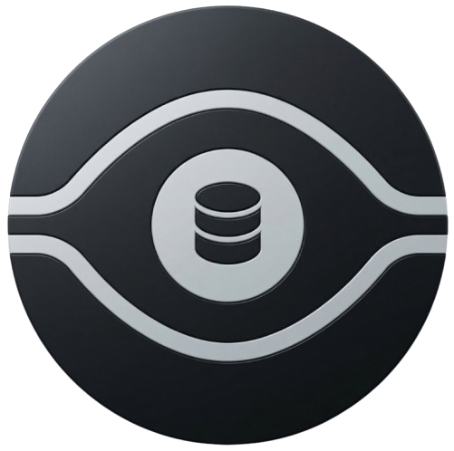
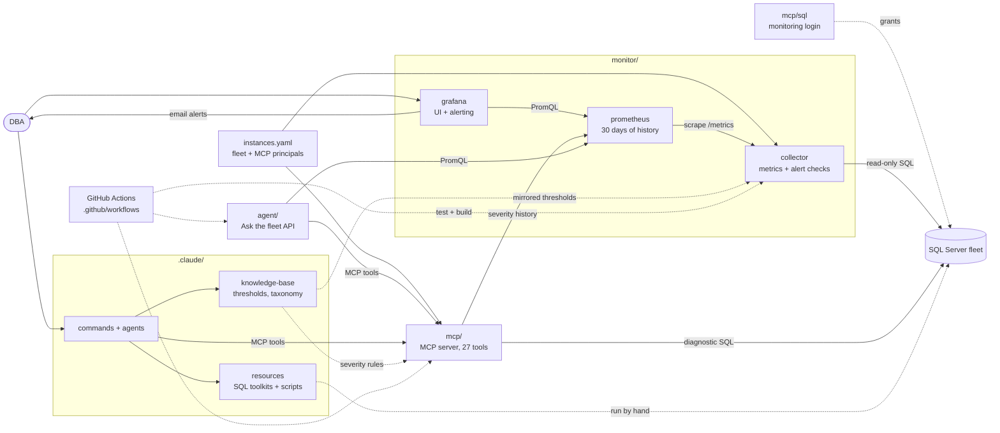

<div align="center">
  
</div>

# Data Eyes

Data Eyes monitors a fleet of Microsoft SQL Servers. A Python **collector** runs fixed,
read-only queries on a schedule; **Prometheus** keeps 30 days of the results;
**Grafana** is the UI (fleet, instances, alerts and collector health) and sends the
alerts. These three live in [monitor/](monitor). An **MCP server** gives AI agents
(Claude Code and other MCP clients) the same fleet through 27 read-only tools.

```text
                 instances.yaml (the fleet)
                  │                    │
                  ▼                    ▼
  collector ──/metrics──▶ Prometheus ──▶ Grafana (UI + alerting, :3000)
  (scheduled SQL,         (30 days)
   56 alert checks)        ▲     ▲
                   history │     │ read-only Prometheus tools
  data-eyes-mcp ───────────┘   agent ("Ask the fleet" API, internal)
  (27 agent tools, live SQL, :8080-8082)
```

## Quick start

Requirements: Docker with Compose, and network access from Docker to your SQL Servers.

1. **Create the local config files.** They are ignored by Git.
   ```powershell
   Copy-Item .env.example .env
   Copy-Item instances.example.yaml instances.yaml
   ```
2. **Create a read-only SQL login** on each SQL Server (review the script first):
   ```powershell
   sqlcmd -S <server> -v LoginName="data_eyes_monitor" Password="<generated>" DatabaseName="master" SchemaName="dbo" -i mcp/sql/provision-readonly-login.sql
   ```
   [provision-alerting-permissions.sql](mcp/sql/provision-alerting-permissions.sql)
   adds the optional grants some alert checks need (msdb history, CommandLog,
   `VIEW ANY DEFINITION`). Each section says which alerts it enables.
3. **Fill in the config** as described in [Configuration](#configuration): your
   servers and their SQL logins in `instances.yaml`, and a strong
   `GF_SECURITY_ADMIN_PASSWORD` in `.env`.
4. **Start the stack:**
   ```powershell
   docker compose up -d --build
   ```
5. **Open http://localhost:3000** and sign in to Grafana with
   `GF_SECURITY_ADMIN_USER` / `GF_SECURITY_ADMIN_PASSWORD`. The home page is the
   Fleet Overview dashboard.

Alerts are evaluated from the start. Email delivery needs the SMTP settings in
`.env` (see [Alerting](#alerting)).

## Configuration

Two local files configure everything. Both are ignored by Git; never commit or
share them, and reference values by name.

| File | Contents | Read by | Template |
|---|---|---|---|
| `instances.yaml` | The fleet: every SQL Server with its connection string and login, and the MCP principals with their grants and token hash | collector, MCP | `instances.example.yaml` |
| `.env` | Everything else: Grafana port, admin and SMTP; the agent's model keys and MCP token | Docker Compose (Grafana, agent) | `.env.example` |

The fleet is defined once. Grafana has no copy of it: it learns the instances
from the collector's metrics.

### `instances.yaml`

```yaml
mcp_security:
  principals:
    production-agent:            # who an MCP caller is
      token_sha256: "<sha256 of its bearer token>"   # HTTP only; never the token itself
      tools: ["*"]               # fnmatch patterns over tool names
      instances: ["prod*"]       # fnmatch patterns over instance names

instances:
  - name: prod1                  # what tools and dashboards call it
    label: "Prod SQL Server 1"
    environment: production      # development | staging | production
    mssql_connection_string: "Driver={ODBC Driver 18 for SQL Server};Server=prod1,1433;UID=data_eyes_monitor;PWD=<password>;Encrypt=yes;TrustServerCertificate=no"
```

Both ODBC Driver 17 and 18 are installed in the images. The collector and the MCP
server connect with the login in the connection string (or `Trusted_Connection=yes`),
so use the read-only login from step 2, never `sa`. The file is mounted only into
those two containers and is re-read when it changes.

### `.env`

| Group | Variables | Purpose |
|---|---|---|
| Grafana | `GRAFANA_BIND_IP` (default `127.0.0.1`), `GF_SECURITY_ADMIN_USER`, `GF_SECURITY_ADMIN_PASSWORD` (required) | UI address and admin. The admin password applies only when Grafana first creates its database; change it later with `docker compose exec grafana grafana cli admin reset-admin-password <new>`. |
| Alert email | `GRAFANA_NOTIFICATION_ADDRESSES`, `GRAFANA_SMTP_HOST`, `GRAFANA_SMTP_USER`, `GRAFANA_SMTP_PASSWORD`, `GRAFANA_SMTP_FROM_ADDRESS`, `GRAFANA_SMTP_FROM_NAME` | SMTP for Grafana's email contact point |
| Agent | `AI_PROVIDER`, `AI_MODEL`, `ANTHROPIC_API_KEY`, `OPENAI_API_KEY`, `OPENAI_BASE_URL`, `LOCAL_AI_BASE_URL`, `AGENT_MCP_TOKEN` | Model provider for the "Ask the fleet" agent, and its MCP token (whose hash is the `ui-agent` principal's `token_sha256`) |

Each container receives only its own variables. The MCP limits (30 s query and
connection timeouts, 50,000 rows, 2 MB responses, 4,000-character cells, 8
concurrent queries, 60 calls per minute per principal) are code defaults; Compose
sets each MCP service's environment, allowlist and `PROMETHEUS_URL`.

## Services and ports

| Service | Port | Notes |
|---|---|---|
| `grafana` | `127.0.0.1:3000` | The UI and alerting; its own sign-in |
| `prometheus` | internal 9090 | Scrapes the collector every 30 s, keeps 30 days |
| `collector` | internal 8090 | `/metrics`, `/health` |
| `agent` | internal 8000 | "Ask the fleet" API. It has no sign-in, so it is not published. |
| `data-eyes-mcp-dev` | `127.0.0.1:8080` | Always started; endpoint `/mcp` |
| `data-eyes-mcp-staging` | `127.0.0.1:8081` | `docker compose --profile staging up -d` |
| `data-eyes-mcp-prod` | `127.0.0.1:8082` | `docker compose --profile production up -d` |

Each MCP service sees only its own environment's instances and credentials; Compose
blanks the other environments' passwords. Run exactly one collector per
`collector-state` volume.

## Collector

[monitor/collector/](monitor/collector) is a FastAPI app that queries each instance on its own
schedule and serves cached results at `/metrics`. Prometheus scrapes never trigger SQL.

- **Metric groups** every 30 s: resources, memory, I/O, waits, counters, activity;
  databases every 5 minutes.
- **56 alert checks** in 7 groups: Availability (9), Backup & integrity (7), Storage (8),
  Tempdb (4), Performance & activity (12), Maintenance (8), Configuration & security (8).
  Defaults live in [catalog.py](monitor/collector/app/alerts/catalog.py) and mirror
  `.claude/knowledge-base/_static/thresholds.yaml`. Override thresholds, exclusions, or
  per-instance settings in [checks.yaml](monitor/collector/checks.yaml) and restart the collector.
- **Severity** is exported as `data_eyes_health_severity{category="alert.<key>"}` and
  `data_eyes_overall_severity`: 0 OK, 1 Unknown, 2 Warning, 3 Critical.
- **Light on production:** separate concurrency lanes for slow checks, a 30-second
  query limit, and checks that time out back off for up to an hour instead of
  retrying every minute. Sessions are tagged `APP=Data Eyes Collector` for Resource
  Governor, and the image pools ODBC connections instead of logging in per query. See [monitor/collector/README.md](monitor/collector/README.md).

## Prometheus

[monitor/prometheus/prometheus.yml](monitor/prometheus/prometheus.yml) scrapes the collector every
30 seconds and keeps 30 days (`--storage.tsdb.retention.time=30d`). Three recording
rules compute batch requests per second, I/O bytes per second, and I/O latency.

## Grafana (UI)

[monitor/grafana/](monitor/grafana) is provisioned from Git: one Prometheus
datasource, the dashboard, and alerting. Grafana never connects to SQL Server. The
**Fleet Overview** dashboard is the home page:

- **Fleet:** status counts, health per check group, every instance with ON/OFF,
  health, wait rate, alert count and the seven check-group columns, plus a 24-hour
  wait trend and Always On / read-only databases.
- **Fleet resources:** CPU, memory, worker threads, disk free, I/O throughput and
  latency per instance.
- **Instance** (pick it with the `instance` variable, or click a name): server
  details, health per check group, resources, databases (state, access mode, Always
  On role, size), checks that are not OK with affected databases, and top activity
  (waits, I/O stall by database, file and drive, deadlocks) over 30 days.
- **Alerts:** open checks with affected databases, checks that could not run, a
  24-hour status timeline, events by hour over 7 days, and the check catalog.
- **Collector:** whether Prometheus scrapes the collector, and every collection
  group's status, last success and duration per instance.

## Alerting

Grafana evaluates 6 alert rules from
[data-eyes-alerts.yml](monitor/grafana/provisioning/alerting/data-eyes-alerts.yml)
every minute against Prometheus: exporter unavailable, SQL Server unavailable,
diagnostic failing, SQL Server warning, SQL Server critical, and SQL Server events.
They forward the severities the collector computes; per-check thresholds stay in
[checks.yaml](monitor/collector/checks.yaml). The email contact point and the
notification policy (grouped by rule and instance, repeated every 4 hours) are in
[contact-points.yml](monitor/grafana/provisioning/alerting/contact-points.yml).

## MCP server

[mcp/](mcp) lets agents inspect the fleet with fixed, read-only tools. There is no
ad-hoc SQL.

| Group | Tools |
|---|---|
| Discovery | `list_configured_instances`, `list_databases`, `list_schemas`, `list_tables`, `describe_table`, `schema_discovery`, `get_relationships`, `sample_table`, `distinct_values`, `get_database_info`, `check_db_connection` |
| Diagnostics | `wait_stats`, `missing_indexes`, `unused_indexes`, `stale_statistics`, `index_fragmentation`, `top_queries`, `db_space`, `backup_health`, `checkdb_health`, `blocking_snapshot`, `ag_health`, `job_health`, `fleet_health_score` |
| History (Prometheus) | `list_tracked_instances`, `get_severity_trend`, `get_latest_snapshot` |

Every SQL tool takes an optional `instance`; most also take `database`. History tools
read the collector's severities from Prometheus; all other tools query SQL Server live.

### Connecting a client

- **Claude Code (stdio):** [.mcp.json](.mcp.json) already registers the server. It
  runs `uv --directory mcp run data-eyes-mcp` as `DEFAULT_PRINCIPAL=development-agent`
  against the `dev` instance.
- **HTTP:** create a token and its hash:
  ```powershell
  python -c "import secrets,hashlib;t=secrets.token_urlsafe(32);print(t);print(hashlib.sha256(t.encode()).hexdigest())"
  ```
  Set the hash as the principal's `token_sha256` in `instances.yaml` (MCP reloads it), and
  point the client at `http://localhost:8080/mcp` (staging 8081, production 8082) with
  `Authorization: Bearer <token>`.

### More SQL Servers

Add each server to `instances.yaml` with its connection string and login, add the name to the
service's `INSTANCE_ALLOWLIST` (or leave the allowlist empty for every instance of that
environment), grant it to the principal, and restart. Then call tools with
`instance="<name>"`.

### Code

| File | Responsibility |
|---|---|
| [main.py](mcp/src/data_eyes_mcp/main.py) | CLI, logging with secret redaction, stdio or HTTP startup |
| [config.py](mcp/src/data_eyes_mcp/config.py) | Settings, `instances.yaml` (cached by modification time), startup validation |
| [auth.py](mcp/src/data_eyes_mcp/auth.py) | Bearer-token middleware, tool and instance grants, rate limit, audit log |
| [db.py](mcp/src/data_eyes_mcp/db.py) | Scoped-login connections, timeouts with cursor cancel, row/cell/byte caps |
| [output.py](mcp/src/data_eyes_mcp/output.py) | JSON envelope marking rows as untrusted database content |
| [queries.py](mcp/src/data_eyes_mcp/queries.py) | Diagnostic SQL and severity rules |
| [tools.py](mcp/src/data_eyes_mcp/tools.py) | All 27 tools behind one `@tool` decorator |

## Security

- **Local ports only.** Every published port (Grafana 3000, MCP 8080-8082) binds to
  `127.0.0.1` by default. There is no TLS proxy in the stack: put one in front of
  Grafana and MCP before exposing them. The agent has no sign-in and is never published.
- **Grafana sign-in.** Grafana's own accounts protect the UI. Dashboard variables are
  filters, not permissions: every Grafana user sees the whole fleet.
- **MCP authentication.** HTTP callers need a bearer token whose SHA-256 hash is a
  principal's `token_sha256` in `instances.yaml`; identity headers are ignored and only `/health` is public. Stdio
  uses `DEFAULT_PRINCIPAL`, and HTTP never falls back to it. Use long random tokens.
- **MCP authorization.** Each principal gets tool and instance grants; everything else
  is denied. Errors only list instances the caller is granted. Grants reload when
  `instances.yaml` changes; token changes need a restart.
- **SQL Server decides data access.** The MCP has no table- or column-level rules. Give
  each environment's MCP login read-only access to only what agents may see.
  `sample_table` and `distinct_values` return real rows, and `top_queries` and
  `blocking_snapshot` show query text and logins from every database (they need
  `VIEW SERVER STATE`).
- **Read-only by construction.** Only fixed statements run; user input reaches SQL
  Server only as bound parameters, quoted identifiers, or escaped literals. MCP
  transactions are never committed.
- **Limits and audit.** Timeouts, concurrency, row, cell, byte, and per-principal rate
  limits apply to every MCP call. Each call, denial, and error is logged as a
  `security_audit` JSON line, without query text. Passwords and connection strings are
  redacted from logs; connection strings are never returned to clients.
- **Prompt injection.** Results are labelled `untrusted_database_content`, and agents
  are told never to follow stored text.
- **CI.** [security.yml](.github/workflows/security.yml) runs the MCP tests,
  validates the Prometheus config, builds the collector, MCP and agent images, audits dependencies with
  `pip-audit`, and scans for secrets with gitleaks.

## Claude Code toolkit

[.claude/](.claude) adds SQL Server DBA workflows for Claude Code:

- **Agents:** `sql-server-dba` (troubleshooting, tuning, maintenance; prefers live MCP
  tools over reading scripts) and `dashboard-app` (collector, Prometheus, Grafana, deployment).
- **Commands:** `/sql-performance`, `/sql-maintenance`, `/sql-scripts`, `/sql-monitor`,
  `/sql-document`, `/sql-kb`, `/sql-pr-review`, `/sql-guidelines`, `/sql-visual-report`,
  `/status`, `/sync-context`, `/memory`.
- **Resources:** performance queries and a tuning workbook, maintenance playbooks with
  Ola Hallengren use cases, and 84 copy-paste-safe scripts in 18 folders.
- **Knowledge base:** static thresholds, taxonomy, naming conventions, and methodology,
  plus per-database knowledge built by `/sql-kb`.

## Development

```powershell
uv run --project monitor/collector python -c "import app.main"   # no test suite for now
docker compose exec collector python -m app.verify              # compare UI values with SQL Server
cd mcp; uv run --extra dev pytest; uv run ruff check src tests
docker build -t data-eyes-mcp mcp
docker build -t data-eyes-collector monitor/collector
docker build -t data-eyes-agent agent
```

<!-- project-map:start -->
## Architecture



Solid arrows are runtime calls; dotted arrows are configuration, mirrored rules, or manual use.

### Repository tree

```text
data-eyes/
├── .claude/                                  Claude Code toolkit
│   ├── agents/                               sql-server-dba, dashboard-app
│   ├── commands/                             12 slash commands
│   ├── knowledge-base/                       Static KB + per-database KBs
│   │   └── _static/                          Thresholds, taxonomy, naming, methodology
│   └── resources/                            SQL toolkits and script library
│       ├── maintenance/                      Ola Hallengren playbooks and schedules
│       │   ├── diagnostics/                  7 live health queries
│       │   │   └── docs/                     One guide per diagnostic
│       │   └── use_cases/                    Ola Hallengren examples
│       ├── performance/                      10-step tuning methodology, workbook
│       │   └── additional_queries/           Diagnostic queries (+ .json.sql)
│       │       └── docs/                     One guide per query
│       └── sql-scripts/                      84 scripts in 18 topics
├── .github/                                  GitHub configuration
│   └── workflows/                            CI: tests, builds, audits
├── agent/                                    "Ask the fleet" API
│   └── app/                                  FastAPI app, tool loop, tools
├── assets/                                   Logo
├── mcp/                                      MCP server (27 read-only tools)
│   ├── sql/                                  Monitoring login templates
│   ├── src/                                  Package source
│   │   └── data_eyes_mcp/                    Tools, auth, db, queries
│   └── tests/                                Unit tests
├── monitor/                                  Collector -> Prometheus -> Grafana
│   ├── collector/                            SQL diagnostics exporter
│   │   └── app/                              Scheduler, SQL client, metrics
│   │       └── alerts/                       Alert catalog and evaluation
│   │           └── checks/                   Check implementations
│   ├── grafana/                              UI and alerting
│   │   ├── dashboards/                       Fleet Overview
│   │   └── provisioning/                     Applied at startup
│   │       ├── alerting/                     6 rules, email, policy
│   │       ├── dashboards/                   Dashboard file provider
│   │       ├── datasources/                  Data Eyes Prometheus
│   │       └── plugins/                      None yet
│   └── prometheus/                           Scrape config, 30 days
│       └── rules/                            3 recording rules
├── .env.example                              Template for .env (Grafana, agent)
├── .mcp.json                                 Claude Code MCP registration (stdio, dev)
├── CLAUDE.md                                 Project instructions for Claude Code
├── README.md                                 Setup, configuration, security
├── docker-compose.yml                        The whole stack
└── instances.example.yaml                    Template for instances.yaml (fleet, MCP principals)
```
<!-- project-map:end -->

## Repository map

| Path | Contents |
|---|---|
| `monitor/collector/` | Scheduled SQL collection, alert checks, Prometheus exporter |
| `monitor/prometheus/` | Scrape config, recording rules |
| `monitor/grafana/` | The UI: dashboards, datasources, alert rules and delivery |
| `agent/` | "Ask the fleet" API (internal) |
| `mcp/` | MCP server, tests, SQL login provisioning scripts |
| `.claude/` | Agents, commands, knowledge base, SQL resources |
| `instances.example.yaml` | Fleet and MCP access template |
| `docker-compose.yml` | The whole stack, with staging and production MCP profiles |

Data Eyes is MIT licensed. See [CONTRIBUTING.md](CONTRIBUTING.md).
