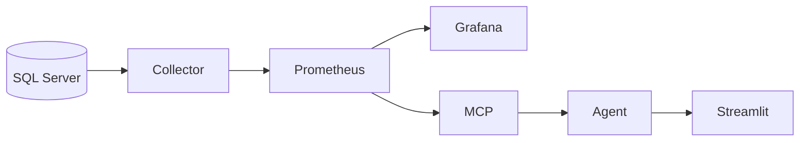
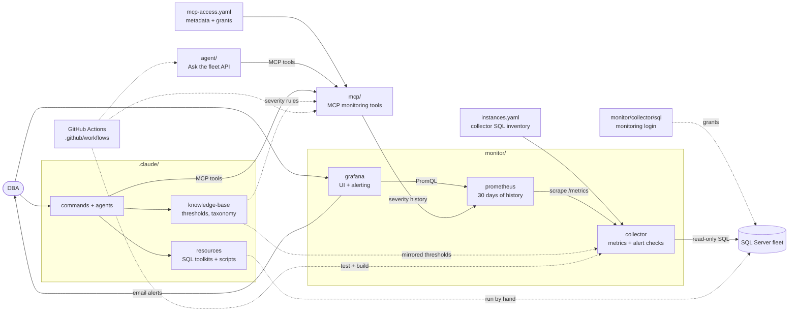

<div align="center">
  
</div>

# Data Eyes

Data Eyes monitors SQL Server through one scheduled collector. Prometheus stores its
measurements for 30 days. Grafana and MCP read those measurements; the agent uses MCP.
Only the collector connects to SQL Server.



## Quick start

Requirements: Docker with Compose, and network access from Docker to your SQL Servers.

1. **Create the local config files.** They are ignored by Git.
   ```powershell
   Copy-Item .env.example .env
   Copy-Item instances.example.yaml instances.yaml
   Copy-Item mcp-access.example.yaml mcp-access.yaml
   ```
2. **Create a read-only SQL login** on each SQL Server (review the script first):
   ```powershell
   sqlcmd -S <server> -v LoginName="data_eyes_monitor" Password="<generated>" DatabaseName="master" SchemaName="dbo" -i monitor/collector/sql/provision-readonly-login.sql
   ```
   [provision-alerting-permissions.sql](monitor/collector/sql/provision-alerting-permissions.sql)
   adds the optional grants some alert checks need (msdb history, CommandLog,
   `VIEW ANY DEFINITION`). Each section says which alerts it enables.
3. **Fill in the config** as described in [Configuration](#configuration): your
   servers and their SQL logins in `instances.yaml`, and a strong
   `GF_SECURITY_ADMIN_PASSWORD` in `.env`.
4. **Start the stack:**
   ```powershell
   docker compose up -d --build
   ```
5. **Open http://localhost:3000** and sign in to Grafana with
   `GF_SECURITY_ADMIN_USER` / `GF_SECURITY_ADMIN_PASSWORD`. The home page is the
   Fleet Overview dashboard.

Alerts are evaluated from the start. Email delivery needs the SMTP settings in
`.env` (see [Alerting](#alerting)).

## Configuration

Three local files configure the stack; all are ignored by Git.

| File | Contents | Read by |
|---|---|---|
| `instances.yaml` | SQL fleet and collector connection strings | Collector only |
| `mcp-access.yaml` | Instance metadata, tool/instance permissions, token hashes | MCP only |
| `.env` | Grafana settings and agent provider keys/MCP token | Compose |

Copy the corresponding `.example` files for a new install. Existing installations
can extract their MCP policy with:

```powershell
uv run --project mcp python scripts/migrate_monitoring_access.py
```

The migration preserves instance grants and token hashes, grants the new monitoring
tool catalog to existing tool users, and leaves the source file unchanged. It refuses
to overwrite an existing access policy. Review narrow tool roles after migration.
Set the agent's token hash for `ui-agent` in `mcp-access.yaml`.

The collector loads `instances.yaml` at startup: restart it after fleet changes.
MCP reloads `mcp-access.yaml` on file changes. Add new instance metadata and grants
there to make newly collected instances available to MCP clients. SQL credentials
must never go into MCP access policy. Grafana discovers instances from metrics.

### `.env`

| Group | Variables | Purpose |
|---|---|---|
| Grafana | `GRAFANA_BIND_IP` (default `127.0.0.1`), `GF_SECURITY_ADMIN_USER`, `GF_SECURITY_ADMIN_PASSWORD` (required) | UI address and admin. The admin password applies only when Grafana first creates its database; change it later with `docker compose exec grafana grafana cli admin reset-admin-password <new>`. |
| Alert email | `GRAFANA_NOTIFICATION_ADDRESSES`, `GRAFANA_SMTP_HOST`, `GRAFANA_SMTP_USER`, `GRAFANA_SMTP_PASSWORD`, `GRAFANA_SMTP_FROM_ADDRESS`, `GRAFANA_SMTP_FROM_NAME` | SMTP for Grafana's email contact point |
| Agent | `AI_PROVIDER`, `AI_MODEL`, `ANTHROPIC_API_KEY`, `OPENAI_API_KEY`, `OPENAI_BASE_URL`, `LOCAL_AI_BASE_URL`, `AGENT_MCP_TOKEN` | Model provider for the "Ask the fleet" agent, and its MCP token (whose hash is the `ui-agent` principal's `token_sha256`) |

Each container receives only its own variables. MCP applies query timeouts,
response/series limits, instance and environment restrictions, concurrency caps,
and per-principal rate limits. See [MCP configuration](mcp/README.md).

## Services and ports

| Service | Port | Notes |
|---|---|---|
| `gateway` | `127.0.0.1:3000` | Grafana and authenticated `/assistant/` chat |
| `grafana` | internal 3000 | Dashboards, sign-in and alerting |
| `prometheus` | `127.0.0.1:9090` | Scrapes the collector every 30 s, keeps 30 days |
| `collector` | internal 8090 | `/metrics`, `/health` |
| `agent` | internal 8000 | "Ask the fleet" API. It has no sign-in, so it is not published. |
| `agent-ui` | internal 8501 | Streamlit embedded in Grafana; [setup](agent/README.md#chat-ui) |
| `data-eyes-mcp-dev` | `127.0.0.1:8080` | Always started; endpoint `/mcp` |
| `data-eyes-mcp-staging` | `127.0.0.1:8081` | `docker compose --profile staging up -d` |
| `data-eyes-mcp-prod` | `127.0.0.1:8082` | `docker compose --profile production up -d` |

Each MCP service sees only its own environment's instances and credentials; Compose
blanks the other environments' passwords. Run exactly one collector per
`collector-state` volume.

## Collector

[monitor/collector/](monitor/collector) is a FastAPI app that queries each instance on its own
schedule and serves cached results at `/metrics`. Prometheus scrapes never trigger SQL.

- **Metric groups** every 30 s: resources, memory, I/O, waits, counters, activity;
  databases every 5 minutes.
- **56 alert checks** in 7 groups: Availability (9), Backup & integrity (7), Storage (8),
  Tempdb (4), Performance & activity (12), Maintenance (8), Configuration & security (8).
  Defaults live in [catalog.py](monitor/collector/app/alerts/catalog.py) and mirror
  `.claude/knowledge-base/_static/thresholds.yaml`. Override thresholds, exclusions, or
  per-instance settings in [checks.yaml](monitor/collector/checks.yaml) and restart the collector.
- **Severity** is exported as `data_eyes_health_severity{category="alert.<key>"}` and
  `data_eyes_overall_severity`: 0 OK, 1 Unknown, 2 Warning, 3 Critical.
- **Light on production:** separate concurrency lanes for slow checks, a 30-second
  query limit, and checks that time out back off for up to an hour instead of
  retrying every minute. Sessions are tagged `APP=Data Eyes Collector` for Resource
  Governor, and the image pools ODBC connections instead of logging in per query. See [monitor/collector/README.md](monitor/collector/README.md).

## Prometheus

[monitor/prometheus/prometheus.yml](monitor/prometheus/prometheus.yml) scrapes the collector every
30 seconds and keeps 30 days (`--storage.tsdb.retention.time=30d`). Three recording
rules compute batch requests per second, I/O bytes per second, and I/O latency.

## Grafana (UI)

[monitor/grafana/](monitor/grafana) is provisioned from Git: one Prometheus
datasource, the dashboard, and alerting. Grafana never connects to SQL Server. The
**Fleet Overview** dashboard is the home page:

- **Fleet:** status counts, health per check group, every instance with ON/OFF,
  health, wait rate, alert count and the seven check-group columns, plus a 24-hour
  wait trend and Always On / read-only databases.
- **Fleet resources:** CPU, memory, worker threads, disk free, I/O throughput and
  latency per instance.
- **Instance** (pick it with the `instance` variable, or click a name): server
  details, health per check group, resources, databases (state, access mode, Always
  On role, size), checks that are not OK with affected databases, and top activity
  (waits, I/O stall by database, file and drive, deadlocks) over 30 days.
- **Alerts:** open checks with affected databases, checks that could not run, a
  24-hour status timeline, events by hour over 7 days, and the check catalog.
- **Collector:** whether Prometheus scrapes the collector, and every collection
  group's status, last success and duration per instance.

## Alerting

Grafana evaluates 6 alert rules from
[data-eyes-alerts.yml](monitor/grafana/provisioning/alerting/data-eyes-alerts.yml)
every minute against Prometheus: exporter unavailable, SQL Server unavailable,
diagnostic failing, SQL Server warning, SQL Server critical, and SQL Server events.
They forward the severities the collector computes; per-check thresholds stay in
[checks.yaml](monitor/collector/checks.yaml). The email contact point and the
notification policy (grouped by rule and instance, repeated every 4 hours) are in
[contact-points.yml](monitor/grafana/provisioning/alerting/contact-points.yml).

## MCP server

[MCP](mcp/README.md) exposes nine monitoring tools: `list_configured_instances`,
`fleet_overview`, `instance_checks`, `list_databases`, `list_metrics`, `query_metric`,
`metric_history`, `get_latest_snapshot`, and `get_severity_trend`.
Queries use named metrics and exact scoped labels, not arbitrary PromQL.

Claude Code uses [.mcp.json](.mcp.json) and the `development-agent` stdio principal.
HTTP clients use `/mcp` with a bearer token matching a hash in `mcp-access.yaml`.
The agent reads MCP tools; its chat is embedded at http://localhost:3000/d/ask-the-fleet/ask-the-fleet.

## Security

- Only the collector receives SQL credentials or has SQL drivers. Its SQL is scheduled.
- MCP authenticates HTTP tokens and enforces tool, instance, and environment scope.
- MCP access policy contains no SQL connection strings; unknown fields are rejected.
- Missing/stale collection is reported explicitly, never converted to healthy zero.
- The gateway requires a Grafana session for chat. Prometheus binds to loopback.
- Grafana HTML panels allow the iframe; restrict dashboard editing to trusted users.
- Grafana variables are filters, not access controls. Grafana users see the fleet.
- Model-facing values are untrusted monitoring data, never instructions.
- CI runs tests, configuration checks, container builds, dependency audits and secret scans.

## Claude Code toolkit

[.claude/](.claude) adds SQL Server DBA workflows for Claude Code:

- **Agents:** `sql-server-dba` (troubleshooting, tuning, maintenance; uses collected monitoring tools) and `dashboard-app` (collector, Prometheus, Grafana, deployment).
- **Commands:** `/sql-performance`, `/sql-maintenance`, `/sql-scripts`, `/sql-monitor`,
  `/sql-document`, `/sql-kb`, `/sql-pr-review`, `/sql-guidelines`, `/sql-visual-report`,
  `/status`, `/sync-context`, `/memory`.
- **Resources:** performance queries and a tuning workbook, maintenance playbooks with
  Ola Hallengren use cases, and 84 copy-paste-safe scripts in 18 folders.
- **Knowledge base:** static thresholds, taxonomy, naming conventions, and methodology,
  plus per-database knowledge built by `/sql-kb`.

## Development

```powershell
uv run --project monitor/collector python -c "import app.main"   # no test suite for now
cd mcp; uv run --extra dev pytest; uv run ruff check src tests
docker build -t data-eyes-mcp mcp
docker build -t data-eyes-collector monitor/collector
docker build -t data-eyes-agent agent
```

<!-- project-map:start -->
## Architecture



Solid arrows are runtime calls; dotted arrows are configuration, mirrored rules, or manual use.

### Repository tree

```text
data-eyes/
├── .claude/                                  Claude Code toolkit
│   ├── agents/                               sql-server-dba, dashboard-app
│   ├── commands/                             12 slash commands
│   ├── knowledge-base/                       Static KB + per-database KBs
│   │   └── _static/                          Thresholds, taxonomy, naming, methodology
│   └── resources/                            SQL toolkits and script library
│       ├── maintenance/                      Ola Hallengren playbooks and schedules
│       │   ├── diagnostics/                  7 live health queries
│       │   │   └── docs/                     One guide per diagnostic
│       │   └── use_cases/                    Ola Hallengren examples
│       ├── performance/                      10-step tuning methodology, workbook
│       │   └── additional_queries/           Diagnostic queries (+ .json.sql)
│       │       └── docs/                     One guide per query
│       └── sql-scripts/                      84 scripts in 18 topics
├── .github/                                  GitHub configuration
│   └── workflows/                            CI: tests, builds, audits
├── agent/                                    "Ask the fleet" API
│   └── app/                                  FastAPI app, tool loop, tools
├── assets/                                   Logo
├── mcp/                                      MCP monitoring tools
│   ├── sql/                                  Monitoring login templates
│   ├── src/                                  Package source
│   │   └── data_eyes_mcp/                    Tools, auth, db, queries
│   └── tests/                                Unit tests
├── monitor/                                  Collector -> Prometheus -> Grafana
│   ├── collector/                            SQL diagnostics exporter
│   │   └── app/                              Scheduler, SQL client, metrics
│   │       └── alerts/                       Alert catalog and evaluation
│   │           └── checks/                   Check implementations
│   ├── grafana/                              UI and alerting
│   │   ├── dashboards/                       Fleet Overview
│   │   └── provisioning/                     Applied at startup
│   │       ├── alerting/                     6 rules, email, policy
│   │       ├── dashboards/                   Dashboard file provider
│   │       ├── datasources/                  Data Eyes Prometheus
│   │       └── plugins/                      None yet
│   └── prometheus/                           Scrape config, 30 days
│       └── rules/                            3 recording rules
├── .env.example                              Template for .env (Grafana, agent)
├── .mcp.json                                 Claude Code MCP registration (stdio, dev)
├── CLAUDE.md                                 Project instructions for Claude Code
├── README.md                                 Setup, configuration, security
├── docker-compose.yml                        The whole stack
└── instances.example.yaml                    Template for collector SQL inventory
```
<!-- project-map:end -->

## Repository map

| Path | Contents |
|---|---|
| `monitor/collector/` | Scheduled SQL collection, alert checks, Prometheus exporter |
| `monitor/prometheus/` | Scrape config, recording rules |
| `monitor/grafana/` | The UI: dashboards, datasources, alert rules and delivery |
| `agent/` | "Ask the fleet" API (internal) |
| `mcp/` | MCP server, tests, SQL login provisioning scripts |
| `.claude/` | Agents, commands, knowledge base, SQL resources |
| `instances.example.yaml` | Fleet and MCP access template |
| `docker-compose.yml` | The whole stack, with staging and production MCP profiles |

Data Eyes is MIT licensed. See [CONTRIBUTING.md](CONTRIBUTING.md).
