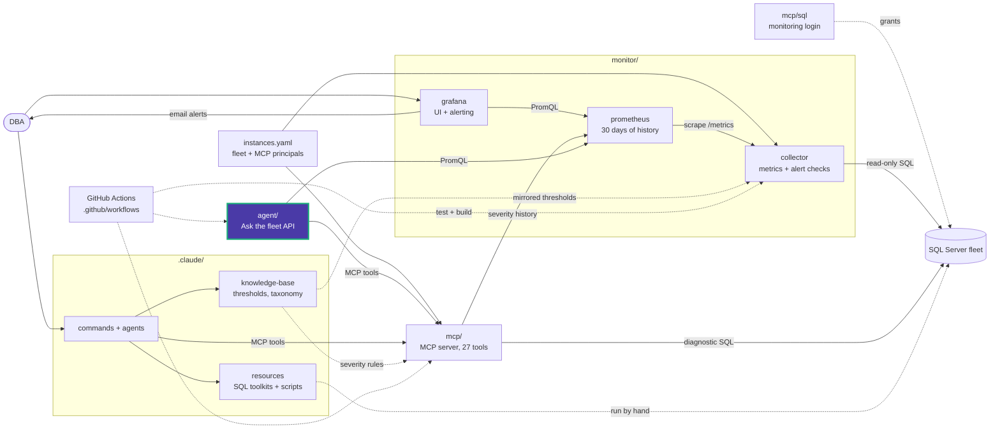

# Agent

The "Ask the fleet" assistant: an internal HTTP API that answers DBA questions about
the monitored SQL Server fleet with an AI model. The root
[docker-compose.yml](../docker-compose.yml) starts it as the `agent` service (internal port 8000).

```text
question ──► agent (:8000) ──► model (anthropic | openai | local)
                 │
                 ├── Prometheus tools (read-only, 30 days of collector metrics)
                 └── MCP tools as principal ui-agent (live health diagnostics, optional)
```

## Layout

| Path | Contents |
|---|---|
| [app/](app/) | FastAPI app, tool loop, Prometheus and MCP tools, settings |
| `pyproject.toml`, `uv.lock` | Dependencies (FastAPI, httpx, anthropic, openai, mcp) |
| `Dockerfile` | Python 3.11 slim image, runs as UID 10001 |

## Endpoints

| Method | Path | Returns |
|---|---|---|
| `GET` | `/api/agent/status` | Provider, model, whether it is configured, whether live diagnostics are on |
| `POST` | `/api/agent/ask` | Server-Sent Events: `status`, `text`, `error`, then `done` |

## Configuration

Settings come from the repository `.env` (template [.env.example](../.env.example)):
`AI_PROVIDER`, `AI_MODEL`, the provider key, and `AGENT_MCP_TOKEN`. Without
`AGENT_MCP_TOKEN` the agent uses Prometheus only. Limits: `AI_MAX_TOOL_CALLS` (8),
`AI_MAX_TOKENS` (2000), `AI_TIMEOUT_SECONDS` (120), `AI_MAX_CONCURRENT_ASKS` (4).

## Security

The API has no sign-in of its own, so Compose does not publish its port. Put
authentication in front of it before exposing it. Provider keys stay in this
container and are never returned by `/status`.

## Development

```powershell
uv run --project agent python -c "import app.main"
docker build -t data-eyes-agent agent
```

<!-- project-map:start -->
## Where this fits

- Reads the collector's metrics from Prometheus (`PROMETHEUS_URL`).
- Calls the MCP servers as principal `ui-agent` for live diagnostics. Its `AGENT_MCP_TOKEN` hash is that principal's `token_sha256` in `instances.yaml`.
- Settings come from the root `.env`; `docker-compose.yml` starts it. It never connects to SQL Server itself.



The highlighted box is this folder. Solid arrows are runtime calls; dotted arrows are configuration, mirrored rules, or manual use.

### In the repository

```text
data-eyes/
├── .claude/                                  Claude Code toolkit
├── .github/                                  GitHub configuration
├── agent/                                    "Ask the fleet" API  ◀ you are here
│   └── app/                                  FastAPI app, tool loop, tools
├── assets/                                   Logo
├── mcp/                                      MCP server (27 read-only tools)
├── monitor/                                  Collector -> Prometheus -> Grafana
├── .env.example                              Template for .env (Grafana, agent)
├── .mcp.json                                 Claude Code MCP registration (stdio, dev)
├── CLAUDE.md                                 Project instructions for Claude Code
├── README.md                                 Setup, configuration, security
├── docker-compose.yml                        The whole stack
└── instances.example.yaml                    Template for instances.yaml (fleet, MCP principals)
```
<!-- project-map:end -->
