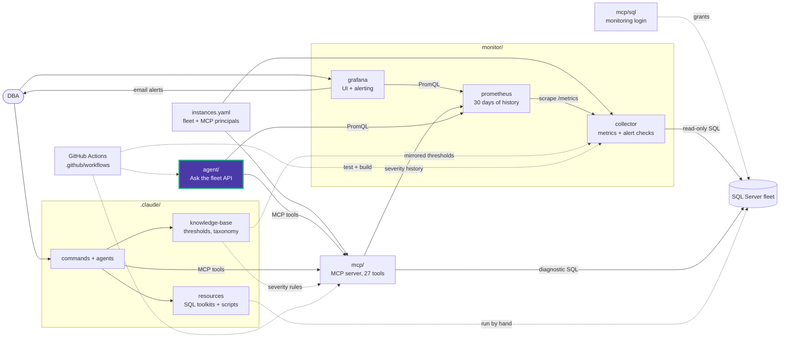

# agent/app

Source of the "Ask the fleet" API. One question runs a bounded tool loop: the model
calls tools, sees their JSON results, and writes the answer.

| Module | Responsibility |
|---|---|
| [main.py](main.py) | FastAPI app: `/api/agent/status`, `/api/agent/ask` (SSE), request validation, concurrency slots |
| [agent.py](agent.py) | System prompt and the tool loop (at most `AI_MAX_TOOL_CALLS` calls per question) |
| [tools.py](tools.py) | Read-only Prometheus tools, with query timeouts and caps on series, points, range (30 days) and result size |
| [mcp_tools.py](mcp_tools.py) | MCP client: offers the MCP servers' health diagnostics to the model as `sql_<tool>`, routed to the environment that serves the instance |
| [config.py](config.py) | Settings from `.env`, the default model per provider, `status()` |

## Rules the code keeps

- Every tool is read-only. Prometheus only holds collector metrics, and the MCP
  allowlist (`ALLOWED_TOOLS`) has health diagnostics only. `sample_table`,
  `distinct_values`, schema discovery and `index_fragmentation` are left out on purpose.
- Label values and database rows come from monitored servers. They are returned
  as data, and the system prompt tells the model never to follow them as instructions.
- MCP environments whose container is not running are skipped.

<!-- project-map:start -->
## Where this fits

- `tools.py` queries Prometheus; `mcp_tools.py` calls the MCP servers; `agent.py` sends both to the model.
- Settings from the root `.env`; started by `docker-compose.yml` as the `agent` service.



The highlighted box is this folder. Solid arrows are runtime calls; dotted arrows are configuration, mirrored rules, or manual use.

### In the repository

```text
data-eyes/
├── .claude/                                  Claude Code toolkit
├── .github/                                  GitHub configuration
├── agent/                                    "Ask the fleet" API
│   └── app/                                  FastAPI app, tool loop, tools  ◀ you are here
├── assets/                                   Logo
├── mcp/                                      MCP server (27 read-only tools)
├── monitor/                                  Collector -> Prometheus -> Grafana
├── .env.example                              Template for .env (Grafana, agent)
├── .mcp.json                                 Claude Code MCP registration (stdio, dev)
├── CLAUDE.md                                 Project instructions for Claude Code
├── README.md                                 Setup, configuration, security
├── docker-compose.yml                        The whole stack
└── instances.example.yaml                    Template for instances.yaml (fleet, MCP principals)
```
<!-- project-map:end -->
