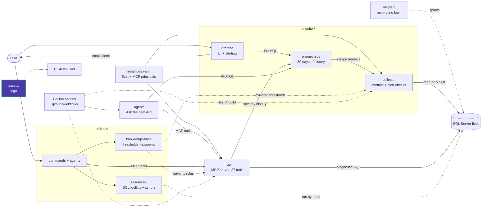

# Assets

Project branding used by the README and documentation.

| File | Use |
|---|---|
| `logo.svg` | Data Eyes logo, vector (preferred) |
| `logo.png` | Data Eyes logo, raster, for places that do not render SVG |

Brand colours used in reports and by `/sql-visual-report`: violet `#4a3aa7` and
aqua `#1baf7a`.

<!-- project-map:start -->
## Where this fits

- The logo is shown at the top of the root `README.md`.
- The brand colours are used by `/sql-visual-report`.



The highlighted box is this folder. Solid arrows are runtime calls; dotted arrows are configuration, mirrored rules, or manual use.

### In the repository

```text
data-eyes/
├── .claude/                                  Claude Code toolkit
├── .github/                                  GitHub configuration
├── agent/                                    "Ask the fleet" API
├── assets/                                   Logo  ◀ you are here
├── mcp/                                      MCP server (27 read-only tools)
├── monitor/                                  Collector -> Prometheus -> Grafana
├── .env.example                              Template for .env (Grafana, agent)
├── .mcp.json                                 Claude Code MCP registration (stdio, dev)
├── CLAUDE.md                                 Project instructions for Claude Code
├── README.md                                 Setup, configuration, security
├── docker-compose.yml                        The whole stack
└── instances.example.yaml                    Template for instances.yaml (fleet, MCP principals)
```
<!-- project-map:end -->
