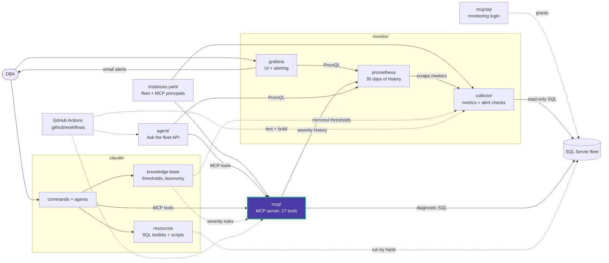

> **Security:** Read the [security hardening guide](../README.md#security) before deploying. HTTP MCP requires bearer tokens; ad-hoc SQL is disabled; MCP ports bind to 127.0.0.1 unless you change them.

# Data Eyes MCP server

This package is the agent-facing interface to Data Eyes. It provides
fixed, read-only SQL Server exploration and DBA tools for the configured fleet
over stdio or Streamable HTTP.

```text
src/data_eyes_mcp/
  main.py     arguments, logging with secret redaction, stdio/HTTP startup
  config.py   settings and instances.yaml (instances + principals), cached by mtime
  auth.py     bearer-token middleware, tool/instance grants, rate limit, audit log
  db.py       scoped-login connections, timeouts with cursor cancel, row/byte caps
  output.py   JSON envelope that marks rows as untrusted database content
  queries.py  fixed diagnostic SQL and severity rules
  tools.py    all 27 tools: discovery, diagnostics, Prometheus history
```

The canonical guide is [docs/features/mcp.md](../README.md#mcp-server). Related guides:

- [Architecture](../README.md)
- [Shared configuration](../README.md#configuration)
- [Deployment](../README.md#quick-start)
- [Development](../README.md#development)
- [MCP security model](../README.md#security)

## Quick local start

```powershell
cd mcp
uv sync --extra dev
uv run pytest
uv run data-eyes-mcp --transport http --bind 127.0.0.1:8080
```

The fleet, SQL logins (inside each connection string) and principals with their
`token_sha256` come from the repository's `instances.yaml`; other settings are
environment variables with code defaults. In the integrated stack, start MCP
together with the collector, Prometheus, and Grafana from the repository root:

```powershell
docker compose up -d --build
```

The shared fleet belongs in `instances.yaml`; do not duplicate production
connection strings in MCP client configuration.

<!-- project-map:start -->
## Where this fits

- Reads the fleet and its principals from `instances.yaml`, and connects with the login created from `mcp/sql/`.
- Clients: Claude Code over stdio (`.mcp.json`), the agent over HTTP, and any other MCP client with a token.
- History tools read the collector's severities (`alert.<key>`) from Prometheus.
- `docker-compose.yml` runs one container per environment (dev, staging, prod).



The highlighted box is this folder. Solid arrows are runtime calls; dotted arrows are configuration, mirrored rules, or manual use.

### In the repository

```text
data-eyes/
├── .claude/                                  Claude Code toolkit
├── .github/                                  GitHub configuration
├── agent/                                    "Ask the fleet" API
├── assets/                                   Logo
├── mcp/                                      MCP server (27 read-only tools)  ◀ you are here
│   ├── sql/                                  Monitoring login templates
│   ├── src/                                  Package source
│   └── tests/                                Unit tests
├── monitor/                                  Collector -> Prometheus -> Grafana
├── .env.example                              Template for .env (Grafana, agent)
├── .mcp.json                                 Claude Code MCP registration (stdio, dev)
├── CLAUDE.md                                 Project instructions for Claude Code
├── README.md                                 Setup, configuration, security
├── docker-compose.yml                        The whole stack
└── instances.example.yaml                    Template for instances.yaml (fleet, MCP principals)
```
<!-- project-map:end -->
