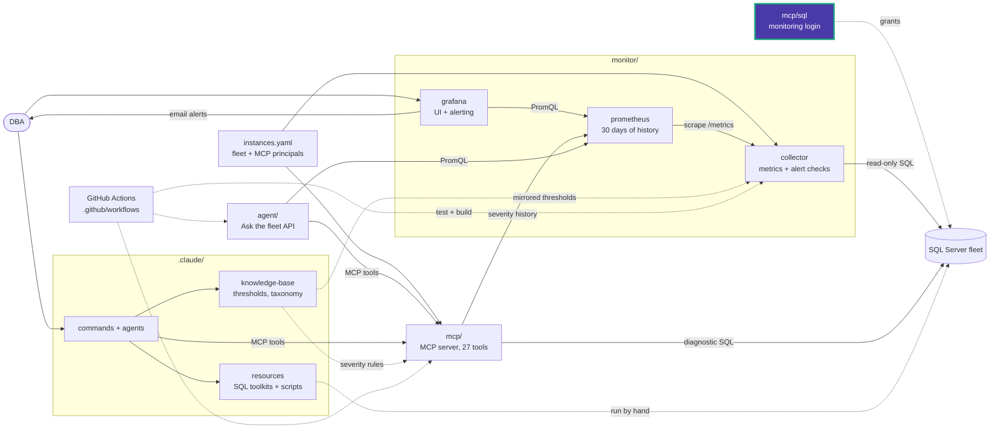

# mcp/sql

T-SQL templates for the SQL Server login that the collector and MCP connect with.
Review them; don't run them unchanged in production. Run them yourself with
`sqlcmd` variables, after reading every grant.

| Script | Purpose |
|---|---|
| [provision-readonly-login.sql](provision-readonly-login.sql) | Creates the monitoring login (password policy on) and grants `VIEW SERVER STATE`, which the instance-level diagnostics need |
| [provision-alerting-permissions.sql](provision-alerting-permissions.sql) | Optional extra grants that specific alert checks need, such as `VIEW ANY DEFINITION` and read access to Ola Hallengren's `CommandLog`. Each section names the checks it enables |

```powershell
sqlcmd -S <server> -v LoginName="data_eyes_monitor" Password="<password>" -i provision-readonly-login.sql
sqlcmd -S <server> -v LoginName="data_eyes_monitor" -i provision-alerting-permissions.sql
```

Put the resulting login in that instance's connection string in `instances.yaml`.
This login decides what MCP tools and alert checks can see. If you skip an optional
section, the checks it covers report UNKNOWN; turn them off in
[monitor/collector/checks.yaml](../../monitor/collector/checks.yaml).

<!-- project-map:start -->
## Where this fits

- Creates the SQL Server login that goes into each connection string in `instances.yaml`, used by both the collector and MCP.
- The optional alerting grants let more collector checks run; without them those checks report UNKNOWN.



The highlighted box is this folder. Solid arrows are runtime calls; dotted arrows are configuration, mirrored rules, or manual use.

### In the repository

```text
data-eyes/
├── .claude/                                  Claude Code toolkit
├── .github/                                  GitHub configuration
├── agent/                                    "Ask the fleet" API
├── assets/                                   Logo
├── mcp/                                      MCP server (27 read-only tools)
│   ├── sql/                                  Monitoring login templates  ◀ you are here
│   ├── src/                                  Package source
│   └── tests/                                Unit tests
├── monitor/                                  Collector -> Prometheus -> Grafana
├── .env.example                              Template for .env (Grafana, agent)
├── .mcp.json                                 Claude Code MCP registration (stdio, dev)
├── CLAUDE.md                                 Project instructions for Claude Code
├── README.md                                 Setup, configuration, security
├── docker-compose.yml                        The whole stack
└── instances.example.yaml                    Template for instances.yaml (fleet, MCP principals)
```
<!-- project-map:end -->
