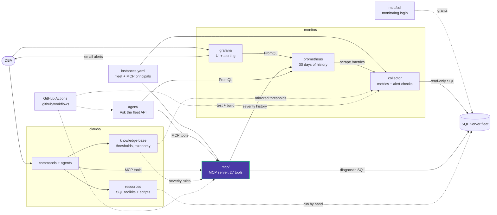

# data_eyes_mcp

The MCP server package. Entry point: `data-eyes-mcp` (`main:run`), or
`python -m data_eyes_mcp.main --transport stdio|http --bind host:port`.

| Module | Responsibility |
|---|---|
| [main.py](main.py) | Arguments, log redaction of passwords and connection strings, stdio or Streamable HTTP startup |
| [config.py](config.py) | Process settings and the shared `instances.yaml` (instances and `mcp_security` principals), re-read when its mtime changes |
| [auth.py](auth.py) | Bearer-token middleware (SHA-256 against `token_sha256`), tool and instance grants (fnmatch), rate limit, audit log |
| [db.py](db.py) | One fixed read-only statement per call: scoped login, worker-thread slots, cursor cancel on timeout, row, cell and byte caps, never commits |
| [output.py](output.py) | JSON envelope that marks every row as untrusted database content |
| [queries.py](queries.py) | Fixed diagnostic SQL and severity rules. Keep it in sync with `.claude/knowledge-base/_static/thresholds.yaml` |
| [tools.py](tools.py) | All 27 tools |

## Tools

| Group | Tools |
|---|---|
| Fleet and discovery | `list_configured_instances`, `list_databases`, `list_schemas`, `list_tables`, `describe_table`, `schema_discovery`, `get_relationships`, `sample_table`, `distinct_values`, `get_database_info`, `check_db_connection` |
| Diagnostics (with `severity`) | `wait_stats`, `missing_indexes`, `unused_indexes`, `stale_statistics`, `index_fragmentation`, `top_queries`, `db_space`, `backup_health`, `checkdb_health`, `blocking_snapshot`, `ag_health`, `job_health`, `fleet_health_score` |
| Prometheus history | `list_tracked_instances`, `get_severity_trend`, `get_latest_snapshot` |

There is no ad-hoc SQL. User input reaches SQL Server only as bound parameters,
bracket-quoted identifiers, or escaped literals.

<!-- project-map:start -->
## Where this fits

- `config.py` reads `instances.yaml`; `db.py` connects to the fleet; `tools.py` queries Prometheus for history.
- `queries.py` mirrors the diagnostics in `.claude/resources/` and the thresholds in `knowledge-base/_static/`.
- Called by Claude Code (`.mcp.json`), the agent, and other MCP clients.



The highlighted box is this folder. Solid arrows are runtime calls; dotted arrows are configuration, mirrored rules, or manual use.

### In the repository

```text
data-eyes/
├── .claude/                                  Claude Code toolkit
├── .github/                                  GitHub configuration
├── agent/                                    "Ask the fleet" API
├── assets/                                   Logo
├── mcp/                                      MCP server (27 read-only tools)
│   ├── sql/                                  Monitoring login templates
│   ├── src/                                  Package source
│   │   └── data_eyes_mcp/                    Tools, auth, db, queries  ◀ you are here
│   └── tests/                                Unit tests
├── monitor/                                  Collector -> Prometheus -> Grafana
├── .env.example                              Template for .env (Grafana, agent)
├── .mcp.json                                 Claude Code MCP registration (stdio, dev)
├── CLAUDE.md                                 Project instructions for Claude Code
├── README.md                                 Setup, configuration, security
├── docker-compose.yml                        The whole stack
└── instances.example.yaml                    Template for instances.yaml (fleet, MCP principals)
```
<!-- project-map:end -->
