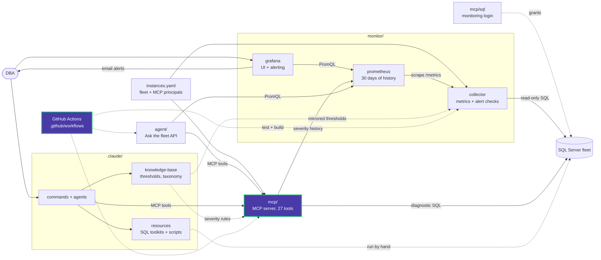

# mcp/tests

Unit tests for the MCP server. They need no SQL Server, Prometheus or real fleet file:
[conftest.py](conftest.py) points `INSTANCES_FILE` at a nonexistent file, blanks
operator settings, and supplies fixture fleets.

| File | Covers |
|---|---|
| [conftest.py](conftest.py) | Environment isolation and shared fixtures |
| [test_config.py](test_config.py) | Fleet filtered to the deployment, reload on file change, duplicate and ambiguous instances, required logins and token hashes |
| [test_auth.py](test_auth.py) | HTTP needs a token and ignores identity headers, default-deny grants, no stdio fallback over HTTP, per-principal rate limit |
| [test_db.py](test_db.py) | Connection string parsing and session tag, row, cell and byte caps, cursor cancel on timeout |
| [test_tools.py](test_tools.py) | Name parsing, bound parameters, grant denials that reveal nothing, output byte cap, PromQL escaping, bounded history, audit of unidentified callers |

```powershell
cd mcp
uv run --extra dev pytest
uv run ruff check src tests
```

CI runs the same suite in [security.yml](../../.github/workflows/security.yml).

<!-- project-map:start -->
## Where this fits

- Tests the MCP package without a fleet, SQL Server or Prometheus.
- Run by `.github/workflows/security.yml` on every push.



The highlighted box is this folder. Solid arrows are runtime calls; dotted arrows are configuration, mirrored rules, or manual use.

### In the repository

```text
data-eyes/
├── .claude/                                  Claude Code toolkit
├── .github/                                  GitHub configuration
├── agent/                                    "Ask the fleet" API
├── assets/                                   Logo
├── mcp/                                      MCP server (27 read-only tools)
│   ├── sql/                                  Monitoring login templates
│   ├── src/                                  Package source
│   └── tests/                                Unit tests  ◀ you are here
├── monitor/                                  Collector -> Prometheus -> Grafana
├── .env.example                              Template for .env (Grafana, agent)
├── .mcp.json                                 Claude Code MCP registration (stdio, dev)
├── CLAUDE.md                                 Project instructions for Claude Code
├── README.md                                 Setup, configuration, security
├── docker-compose.yml                        The whole stack
└── instances.example.yaml                    Template for instances.yaml (fleet, MCP principals)
```
<!-- project-map:end -->
