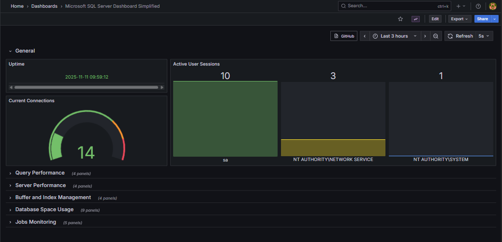
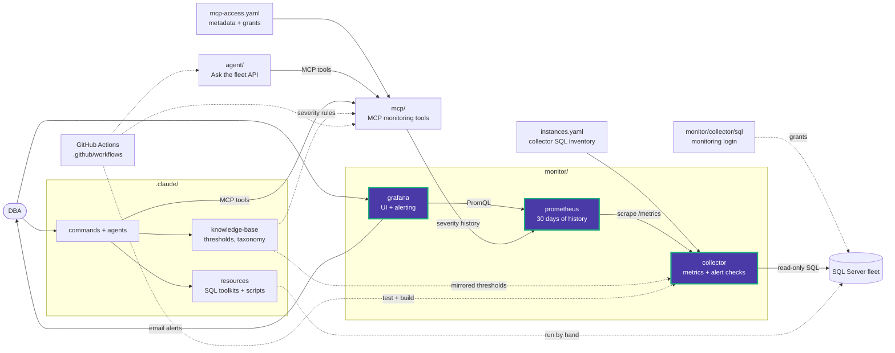

# Monitor

The Data Eyes monitoring pipeline: the **collector** queries the SQL Server fleet,
**Prometheus** keeps 30 days of its results, and **Grafana** is the UI and does the
alerting. All three are started by the root [docker-compose.yml](../docker-compose.yml);
there is no separate compose file here.



```text
instances.yaml ──► collector (:8090) ──/metrics──► Prometheus (:9090, 30 days)
                   fixed read-only SQL                    │
                                                          ▼
                                     Grafana (http://localhost:3000)
                                     Fleet Overview (home) + alert rules ──► email
```

## Layout

```text
monitor/
├── collector/                 SQL diagnostics exporter (see collector/README.md)
│   └── checks.yaml            Alert check overrides: thresholds, exclusions, per instance
├── prometheus/
│   ├── prometheus.yml         Scrapes the collector every 30 s
│   └── rules/recording.yml    3 recording rules (no alerting rules: Grafana alerts)
├── grafana/
│   ├── grafana.ini            SMTP, root URL, home dashboard
│   ├── provisioning/
│   │   ├── datasources/       Data Eyes Prometheus (the only datasource)
│   │   ├── dashboards/        Loads grafana/dashboards/
│   │   └── alerting/          data-eyes-alerts.yml (6 rules), contact-points.yml (email + policy)
│   └── dashboards/
│       └── fleet_overview.json   The Data Eyes UI
```

Settings and secrets for all of this live in the repository's single `.env`
(template: [.env.example](../.env.example)); the fleet lives in `instances.yaml`.

## Setup

1. Fill in `.env` and `instances.yaml` at the repository root (see the root README).
2. From the repository root: `docker compose up -d --build`.
3. Open http://localhost:3000 and sign in with `GF_SECURITY_ADMIN_USER` /
   `GF_SECURITY_ADMIN_PASSWORD`.

The admin password applies only when Grafana first creates its database (the
`grafana-data` volume). To change it afterwards:

```powershell
docker compose exec grafana grafana cli admin reset-admin-password <new-password>
```

Grafana listens on `127.0.0.1` by default (`GRAFANA_BIND_IP` in the root `.env`). Put a
TLS reverse proxy in front before exposing it.

## Dashboard

### Fleet Overview (home page)

Reads only the Data Eyes Prometheus, so it shows exactly what the collector measured.
Grafana never connects to SQL Server.
Filter with the `environment` and `instance` variables.

| Section | Contents |
|---|---|
| Fleet | Status counts, health per check group, one row per instance (ON/OFF, health, wait rate, alerts, AV BK ST TD PF MT SC columns, databases, type, version), 24 h wait trend, Always On / read-only databases |
| Fleet resources | SQL and host CPU, memory vs target, available memory, worker threads, disk free, I/O throughput and latency |
| Instance | Server details, health per check group, CPU, buffer cache hit, page life expectancy, AG redo queue, disk read, batch requests, databases, checks not OK, affected databases, 30-day top activity |
| Alerts | Critical / warning / unknown / unreachable / failing checks / events, open alerts, affected databases, 24 h status timeline, checks that could not run, events per hour (7 days), check catalog |
| Collector | Exporter scraped, collection groups failing, slowest group, every group's status, last success and duration |

## Alerting

Grafana evaluates [data-eyes-alerts.yml](grafana/provisioning/alerting/data-eyes-alerts.yml)
every minute against Prometheus:

| Rule | Fires when | Severity |
|---|---|---|
| DataEyesExporterUnavailable | Prometheus cannot scrape the collector for 2 min | critical |
| SqlServerUnavailable | A SQL Server is unreachable for 1 min | critical |
| DataEyesDiagnosticFailing | A collection group or check fails for 2 min | warning |
| SqlServerWarning | A check is at Warning | warning |
| SqlServerCritical | A check is at Critical | critical |
| SqlServerEvents | An event check (restart, failed job, new login, ...) fired in the last 5 min | warning |

Thresholds for each check are the collector's: change them in
[collector/checks.yaml](collector/checks.yaml) and restart the collector. Delivery is
the email contact point and policy in
[contact-points.yml](grafana/provisioning/alerting/contact-points.yml), grouped by rule
and instance and repeated every 4 hours.

### Email (SMTP)

Set `GRAFANA_SMTP_*` and `GRAFANA_NOTIFICATION_ADDRESSES` in `.env`, then
`docker compose restart grafana`. For Gmail:

1. Enable 2-factor authentication on the Google account.
2. Create an [App Password](https://myaccount.google.com/apppasswords).
3. Use it as `GRAFANA_SMTP_PASSWORD`.

## Maintenance

```powershell
# Back up Grafana's database (users, alert state, UI-saved changes)
docker run --rm -v src_grafana-data:/data -v ${PWD}:/backup alpine tar czf /backup/grafana-backup.tar.gz /data

# Apply provisioning or dashboard edits from Git
docker compose restart grafana
```

Dashboards edited in the UI are saved in Grafana's database; copy the JSON back into
`grafana/dashboards/` to keep the change in Git.

<!-- project-map:start -->
## Where this fits

- The collector reads `instances.yaml` and queries the fleet; Prometheus scrapes it; Grafana shows and alerts on the results.
- MCP's history tools and the agent read the same Prometheus.
- `docker-compose.yml` starts all three; their settings live in the root `.env`.



The highlighted box is this folder. Solid arrows are runtime calls; dotted arrows are configuration, mirrored rules, or manual use.

### In the repository

```text
data-eyes/
├── .claude/                                  Claude Code toolkit
├── .github/                                  GitHub configuration
├── agent/                                    "Ask the fleet" API
├── assets/                                   Logo
├── mcp/                                      MCP monitoring tools
├── monitor/                                  Collector -> Prometheus -> Grafana  ◀ you are here
│   ├── collector/                            SQL diagnostics exporter
│   ├── grafana/                              UI and alerting
│   └── prometheus/                           Scrape config, 30 days
├── .env.example                              Template for .env (Grafana, agent)
├── .mcp.json                                 Claude Code MCP registration (stdio, dev)
├── CLAUDE.md                                 Project instructions for Claude Code
├── README.md                                 Setup, configuration, security
├── docker-compose.yml                        The whole stack
└── instances.example.yaml                    Template for collector SQL inventory
```
<!-- project-map:end -->
