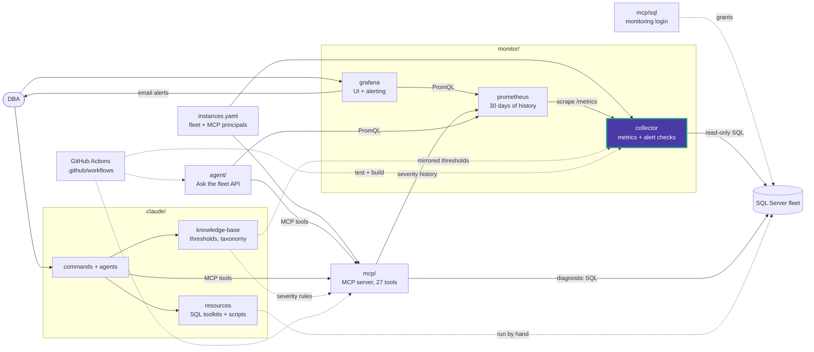

# Data Eyes collector

Independent SQL Server metrics exporter. See [architecture](../README.md),
[metric contract](../README.md#collector), and [configuration](../README.md#configuration).

Run one process/replica per fleet and checkpoint volume. Collection is scheduled
independently of scrapes. Slow checks use a separate SQL concurrency lane.

## Load on monitored servers

The collector is built to stay cheap on busy production instances.

### Timeouts do not retry every minute

The SQL client raises a separate error, `QueryLimitExceeded`, when a query hits the
30-second limit or the result-size cap
([sql.py](app/sql.py)).

- After that error, the check waits its normal interval before retrying, capped at one
  hour ([scheduler.py](app/scheduler.py)). A daily check that keeps timing out costs at
  most 24 runs a day instead of 1,440.
- Connection, queue and permission errors still retry after 60 seconds.
- Trade-off: a daily check that times out shows UNKNOWN for up to an hour.

### `slow_queries` reads the plan cache cheaply

The check ([performance.py](app/alerts/checks/performance.py)) picks the top
10 queries first and looks up SQL text for only those 10, instead of for every plan
used in the last 15 minutes. It runs without parallelism (`OPTION (MAXDOP 1)`) and
skips rows with zero executions.

### Sessions identify themselves

Each connection includes `APP=Data Eyes Collector`, so collector sessions appear under
that `program_name` and can be classified by Resource Governor.

- Change the name with `SQL_APPLICATION_NAME` ([config.py](app/config.py)).
- An `APP=` already in the connection string takes precedence.

The MCP server does the same with `APP=Data Eyes MCP` (`MSSQL_APPLICATION_NAME`).

## Scheduling across the fleet

- **Fast cycle (30 s):** up to `SQL_MAX_CONCURRENT_QUERIES` instances (default 8) run
  their cycle at once. A cycle stops when it uses up its interval, so an overloaded
  instance releases its slot instead of stalling the rest of the fleet. Groups it
  skipped run first in its next cycle.
- **Alert checks:** all instances share `SQL_MAX_BACKGROUND_QUERIES` slots (default 2).
  A check waits up to `SQL_BACKGROUND_QUEUE_TIMEOUT_SECONDS` (default 60) for a slot
  rather than failing as UNKNOWN. Checks in the same cycle share queries they have in
  common.
- An unexpected error ends only the current cycle; the loop logs it and continues.

Error-log checks also read archive #1 when the current log was cycled since the last
read, and `slow_file_growth` resumes from the previous trace file after a rollover,
so lines written just before a rollover are not missed.

<!-- project-map:start -->
## Where this fits

- Reads the fleet from `instances.yaml` and overrides from `checks.yaml`, and connects with the login from `mcp/sql/`.
- Prometheus scrapes its `/metrics`; Grafana alerts on the severities it exports; MCP history reads them.
- Its alert defaults mirror `.claude/knowledge-base/_static/thresholds.yaml`.



The highlighted box is this folder. Solid arrows are runtime calls; dotted arrows are configuration, mirrored rules, or manual use.

### In the repository

```text
data-eyes/
├── .claude/                                  Claude Code toolkit
├── .github/                                  GitHub configuration
├── agent/                                    "Ask the fleet" API
├── assets/                                   Logo
├── mcp/                                      MCP server (27 read-only tools)
├── monitor/                                  Collector -> Prometheus -> Grafana
│   ├── collector/                            SQL diagnostics exporter  ◀ you are here
│   │   └── app/                              Scheduler, SQL client, metrics
│   ├── grafana/                              UI and alerting
│   └── prometheus/                           Scrape config, 30 days
├── .env.example                              Template for .env (Grafana, agent)
├── .mcp.json                                 Claude Code MCP registration (stdio, dev)
├── CLAUDE.md                                 Project instructions for Claude Code
├── README.md                                 Setup, configuration, security
├── docker-compose.yml                        The whole stack
└── instances.example.yaml                    Template for instances.yaml (fleet, MCP principals)
```
<!-- project-map:end -->
