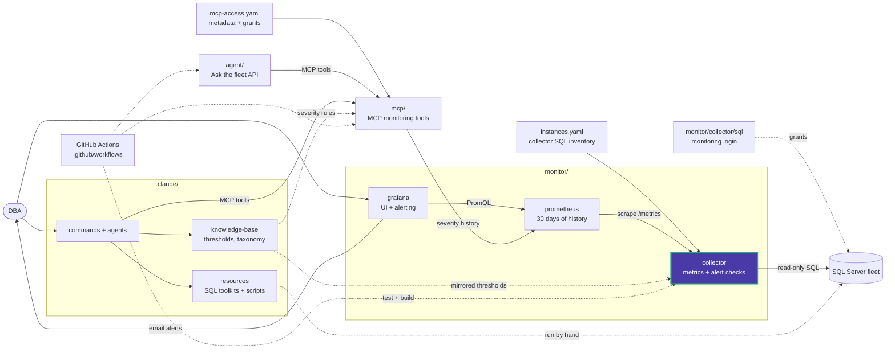

# collector/app

Source of the collector: a FastAPI exporter that runs fixed read-only SQL on its own
schedule and serves the cached results. A Prometheus scrape only reads the cache and
never runs SQL.

| Module | Responsibility |
|---|---|
| [main.py](main.py) | FastAPI app, `/metrics` and `/health`, starts the scheduler on startup |
| [config.py](config.py) | Settings (`INSTANCES_FILE`, `CHECK_SETTINGS_FILE`, `STATE_FILE`, intervals, concurrency), loads `instances.yaml` and `checks.yaml` |
| [sql.py](sql.py) | SQL Server client: worker threads for pyodbc, separate lanes for metrics and slow checks, 30 s query limit, result-size cap, `APP=Data Eyes Collector` |
| [scheduler.py](scheduler.py) | Two loops per instance (metric cycle, alert check cycle), back-off after timeouts, cached samples, check watermarks saved to `STATE_FILE` |
| [metrics.py](metrics.py) | The 7 metric groups and their DMV SQL |
| [alerts/](alerts/) | Alert catalog, evaluation, and the check implementations |
| [verify.py](verify.py) | Pre-production check: compares SQL Server with what Prometheus holds |

## Metric groups

| Group | Interval | Reads |
|---|---|---|
| `resources` | 30 s | SQL and host CPU, page life expectancy, buffer cache hit, batch requests, disk reads, worker threads |
| `memory` | 30 s | SQL memory, target memory, available host memory, page faults |
| `io` | 30 s | Per-file I/O operations, bytes and stall time |
| `waits` | 30 s | Wait time by category |
| `counters` | 30 s | Deadlocks, SQL errors |
| `activity` | 30 s | Active requests per database, blocked sessions, longest blocking wait |
| `databases` | 5 min | Size and state per database, volume size and free space, server info |

Values that are cumulative since instance start are exported as counters, so
Prometheus computes the rates. SQL text, session identities and event bodies are
never metric labels.

## Verify before production

```powershell
docker compose exec collector python -m app.verify
docker compose exec collector python -m app.verify --instance prod1 --only FAIL,WARN
```

Each test reads SQL Server with its own query, independent of the collector's SQL,
and compares the result with Prometheus. The command exits with code 1 when any test
fails, so it can gate a release.

<!-- project-map:start -->
## Where this fits

- `config.py` reads `instances.yaml` and `checks.yaml`; `sql.py` queries the fleet; `main.py` serves `/metrics` to Prometheus.
- Every metric name here is what the Grafana dashboard, the agent and MCP query.



The highlighted box is this folder. Solid arrows are runtime calls; dotted arrows are configuration, mirrored rules, or manual use.

### In the repository

```text
data-eyes/
├── .claude/                                  Claude Code toolkit
├── .github/                                  GitHub configuration
├── agent/                                    "Ask the fleet" API
├── assets/                                   Logo
├── mcp/                                      MCP monitoring tools
├── monitor/                                  Collector -> Prometheus -> Grafana
│   ├── collector/                            SQL diagnostics exporter
│   │   └── app/                              Scheduler, SQL client, metrics  ◀ you are here
│   │       └── alerts/                       Alert catalog and evaluation
│   ├── grafana/                              UI and alerting
│   └── prometheus/                           Scrape config, 30 days
├── .env.example                              Template for .env (Grafana, agent)
├── .mcp.json                                 Claude Code MCP registration (stdio, dev)
├── CLAUDE.md                                 Project instructions for Claude Code
├── README.md                                 Setup, configuration, security
├── docker-compose.yml                        The whole stack
└── instances.example.yaml                    Template for collector SQL inventory
```
<!-- project-map:end -->
