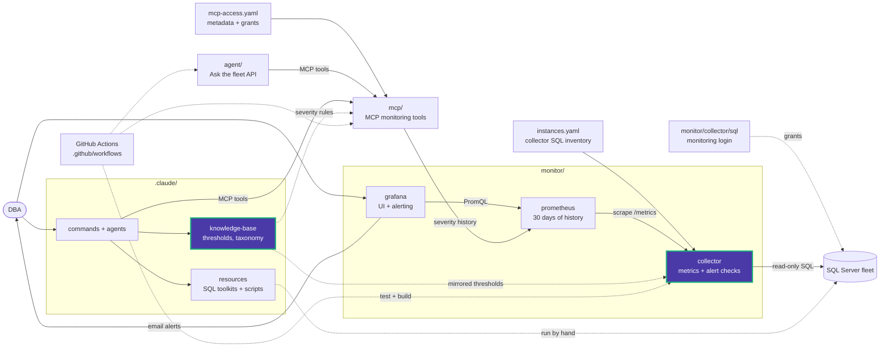

# collector/app/alerts

The alert checks the collector evaluates for every instance. Grafana alerts on their
results; the checks themselves live only here.

| Module | Responsibility |
|---|---|
| [catalog.py](catalog.py) | `CATALOG`: every check's key, name, group, kind, tier, unit, default thresholds and required permission |
| [evaluation.py](evaluation.py) | Pure evaluation: settings inheritance (catalog, fleet, instance), thresholds, confirmation samples, the worst severity |
| [models.py](models.py) | `Finding`, `Occurrence`, the per-cycle `CheckContext`, and the `checks.yaml` input models |
| [checks/](checks/) | The SQL behind each check, registered by key |

## Concepts

- **Kind.** A `state` check holds a severity until it clears (log 92% full). An
  `event` check is a one-off occurrence that never clears (failed job, restart),
  and it is delivered once.
- **Tier.** How often the check runs: `fast`, `standard`, `slow` or `daily`.
- **Severity.** OK = 0, UNKNOWN = 1, WARNING = 2, CRITICAL = 3. A check that cannot
  run (missing permission, timeout) is UNKNOWN, never OK.

## Groups

| Group | Checks |
|---|---|
| Availability | 9 |
| Backup & integrity | 7 |
| Storage | 8 |
| Tempdb | 4 |
| Performance | 12 |
| Maintenance | 8 |
| Configuration & security | 8 |

## Changing thresholds

- **Defaults:** edit `catalog.py` together with the `alerts:` section of
  [thresholds.yaml](../../../../.claude/knowledge-base/_static/thresholds.yaml);
  the two must match.
- **One deployment:** override in [checks.yaml](../../checks.yaml) and restart the
  collector.

<!-- project-map:start -->
## Where this fits

- `catalog.py` mirrors the `alerts:` section of `.claude/knowledge-base/_static/thresholds.yaml`; `monitor/collector/checks.yaml` overrides it.
- Results are exported as `data_eyes_health_severity{category="alert.<key>"}`. Grafana's `SqlServerWarning`, `SqlServerCritical` and `SqlServerEvents` rules fire on them, and MCP's `get_severity_trend` reads them.



The highlighted box is this folder. Solid arrows are runtime calls; dotted arrows are configuration, mirrored rules, or manual use.

### In the repository

```text
data-eyes/
├── .claude/                                  Claude Code toolkit
├── .github/                                  GitHub configuration
├── agent/                                    "Ask the fleet" API
├── assets/                                   Logo
├── mcp/                                      MCP monitoring tools
├── monitor/                                  Collector -> Prometheus -> Grafana
│   ├── collector/                            SQL diagnostics exporter
│   │   └── app/                              Scheduler, SQL client, metrics
│   │       └── alerts/                       Alert catalog and evaluation  ◀ you are here
│   │           └── checks/                   Check implementations
│   ├── grafana/                              UI and alerting
│   └── prometheus/                           Scrape config, 30 days
├── .env.example                              Template for .env (Grafana, agent)
├── .mcp.json                                 Claude Code MCP registration (stdio, dev)
├── CLAUDE.md                                 Project instructions for Claude Code
├── README.md                                 Setup, configuration, security
├── docker-compose.yml                        The whole stack
└── instances.example.yaml                    Template for collector SQL inventory
```
<!-- project-map:end -->
