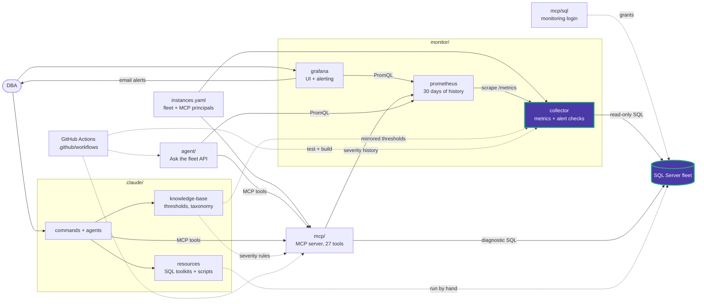

# collector/app/alerts/checks

One function per alert check, registered with `@check("<key>")`. Importing this
package ([\_\_init\_\_.py](__init__.py)) imports every module, which fills `CHECKS`.
A catalog entry runs only if a check with the same key is registered.

| Module | Catalog group | Checks |
|---|---|---|
| [availability.py](availability.py) | Availability | `sql_server_connection`, `sql_server_restarted`, `agent_service_stopped`, `database_status`, `ag_health`, `ag_failover`, `ag_data_loss_risk`, `failover_cluster_status`, `log_shipping_latency` |
| [backups.py](backups.py) | Backup & integrity | `full_backup_age`, `log_backup_age`, `backup_failed`, `checkdb_age`, `database_corruption`, `page_corruption`, `io_corruption_errors` |
| [storage.py](storage.py) | Storage, Tempdb | `disk_space`, `transaction_log_health`, `maxsize_growth`, `database_growth`, `slow_file_growth`, `vlf_count`, `io_pending`, `slow_disk`, `tempdb_data_utilization`, `tempdb_version_store`, `tempdb_log_usage`, `tempdb_contention` |
| [performance.py](performance.py) | Performance | `cpu_utilization`, `memory_available`, `page_life_expectancy`, `memory_grants_pending`, `threadpool_exhaustion`, `blocking`, `long_running_process`, `slow_queries`, `query_regression`, `database_errors`, `login_failed` |
| [maintenance.py](maintenance.py) | Maintenance | `job_failed`, `job_disabled_or_deleted`, `rebuild_failed`, `index_fragmentation`, `stale_statistics`, `identity_values`, `new_database`, `version_support` |
| [security.py](security.py) | Configuration & security | `config_changed`, `max_server_memory_unset`, `auto_shrink_close`, `page_verify`, `sysadmin_changed`, `login_created`, `sa_enabled`, `certificate_expiry` |
| [registry.py](registry.py) | — | `@check` decorator, `CHECKS`, shared helpers (UTC conversion, per-database loops, error-log reading, digests) |

## Writing a check

- Read-only SQL only. Return raw measurements; `evaluation.py` applies the
  thresholds.
- Details carry metadata only (names, files, logins), never query text, because
  they are sent by email.
- Add the catalog entry in [catalog.py](../catalog.py) and its default in
  `thresholds.yaml`, then register the function here.

<!-- project-map:start -->
## Where this fits

- Each check runs read-only SQL against the fleet with the login from `mcp/sql/`; the catalog names the permission each one needs.
- Its results flow through Prometheus to Grafana alerts and MCP history.



The highlighted box is this folder. Solid arrows are runtime calls; dotted arrows are configuration, mirrored rules, or manual use.

### In the repository

```text
data-eyes/
├── .claude/                                  Claude Code toolkit
├── .github/                                  GitHub configuration
├── agent/                                    "Ask the fleet" API
├── assets/                                   Logo
├── mcp/                                      MCP server (27 read-only tools)
├── monitor/                                  Collector -> Prometheus -> Grafana
│   ├── collector/                            SQL diagnostics exporter
│   │   └── app/                              Scheduler, SQL client, metrics
│   │       └── alerts/                       Alert catalog and evaluation
│   │           └── checks/                   Check implementations  ◀ you are here
│   ├── grafana/                              UI and alerting
│   └── prometheus/                           Scrape config, 30 days
├── .env.example                              Template for .env (Grafana, agent)
├── .mcp.json                                 Claude Code MCP registration (stdio, dev)
├── CLAUDE.md                                 Project instructions for Claude Code
├── README.md                                 Setup, configuration, security
├── docker-compose.yml                        The whole stack
└── instances.example.yaml                    Template for instances.yaml (fleet, MCP principals)
```
<!-- project-map:end -->
