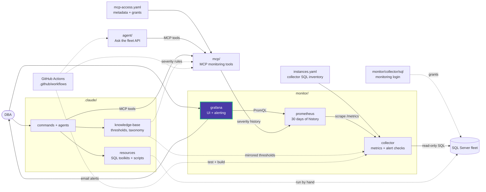

# monitor/grafana

Grafana is the Data Eyes UI and does the alerting. It reads only the Data Eyes
Prometheus and never connects to SQL Server. The root
[docker-compose.yml](../../docker-compose.yml) mounts each part read-only.

| Path | Mounted at | Contents |
|---|---|---|
| [grafana.ini](grafana.ini) | `/etc/grafana/grafana.ini` | SMTP (from `GRAFANA_SMTP_*`), root URL, Fleet Overview as home dashboard, commented Azure AD sign-in example |
| [provisioning/](provisioning/) | `/etc/grafana/provisioning` | Datasource, dashboard provider, alert rules, contact point and policy |
| [dashboards/](dashboards/) | `/etc/grafana/dashboards` | Dashboard JSON |

Users, alert state and dashboard edits made in the UI live in the `grafana-data`
volume. Files here win on restart, so copy UI edits back into Git.

```powershell
docker compose restart grafana   # apply edits to these files
```

See [monitor/README.md](../README.md) for the dashboard sections, alert rules and
SMTP setup.

<!-- project-map:start -->
## Where this fits

- Reads only Prometheus, never SQL Server.
- Sends alert email with the SMTP settings from the root `.env`.
- The DBA's main screen: Fleet Overview is the home page.



The highlighted box is this folder. Solid arrows are runtime calls; dotted arrows are configuration, mirrored rules, or manual use.

### In the repository

```text
data-eyes/
├── .claude/                                  Claude Code toolkit
├── .github/                                  GitHub configuration
├── agent/                                    "Ask the fleet" API
├── assets/                                   Logo
├── mcp/                                      MCP monitoring tools
├── monitor/                                  Collector -> Prometheus -> Grafana
│   ├── collector/                            SQL diagnostics exporter
│   ├── grafana/                              UI and alerting  ◀ you are here
│   │   ├── dashboards/                       Fleet Overview
│   │   └── provisioning/                     Applied at startup
│   └── prometheus/                           Scrape config, 30 days
├── .env.example                              Template for .env (Grafana, agent)
├── .mcp.json                                 Claude Code MCP registration (stdio, dev)
├── CLAUDE.md                                 Project instructions for Claude Code
├── README.md                                 Setup, configuration, security
├── docker-compose.yml                        The whole stack
└── instances.example.yaml                    Template for collector SQL inventory
```
<!-- project-map:end -->

## Embedded fleet assistant

Use the **Ask the fleet** link on Fleet Overview to open the chat dashboard.
The iframe uses `/assistant/` through the authenticated [gateway](../gateway/README.md).
