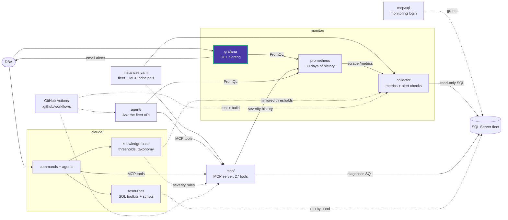

# monitor/grafana/dashboards

Dashboard JSON loaded by the file provider in
[provisioning/dashboards](../provisioning/dashboards/). Grafana loads `*.json` files
only; subfolders become Grafana folders.

| File | Dashboard |
|---|---|
| [fleet_overview.json](fleet_overview.json) | **Fleet Overview**, the home page: Fleet, Fleet resources, Instance, Alerts and Collector sections, filtered by `environment` and `instance` |

UI edits are allowed but saved only in Grafana's database. To keep a change, export
the dashboard JSON over the file here and restart Grafana.

<!-- project-map:start -->
## Where this fits

- Panels query the `dataeyes_prometheus` datasource for the metric names defined in `monitor/collector/app/metrics.py`.



The highlighted box is this folder. Solid arrows are runtime calls; dotted arrows are configuration, mirrored rules, or manual use.

### In the repository

```text
data-eyes/
├── .claude/                                  Claude Code toolkit
├── .github/                                  GitHub configuration
├── agent/                                    "Ask the fleet" API
├── assets/                                   Logo
├── mcp/                                      MCP server (27 read-only tools)
├── monitor/                                  Collector -> Prometheus -> Grafana
│   ├── collector/                            SQL diagnostics exporter
│   ├── grafana/                              UI and alerting
│   │   ├── dashboards/                       Fleet Overview  ◀ you are here
│   │   └── provisioning/                     Applied at startup
│   └── prometheus/                           Scrape config, 30 days
├── .env.example                              Template for .env (Grafana, agent)
├── .mcp.json                                 Claude Code MCP registration (stdio, dev)
├── CLAUDE.md                                 Project instructions for Claude Code
├── README.md                                 Setup, configuration, security
├── docker-compose.yml                        The whole stack
└── instances.example.yaml                    Template for instances.yaml (fleet, MCP principals)
```
<!-- project-map:end -->
