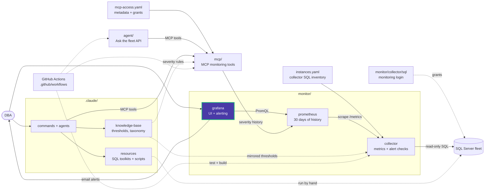

# monitor/grafana/provisioning

Files Grafana applies at startup. Each subfolder is one provisioning type.

| Folder | Provisions |
|---|---|
| [datasources/](datasources/) | Data Eyes Prometheus, the only datasource |
| [dashboards/](dashboards/) | The file provider that loads `monitor/grafana/dashboards` |
| [alerting/](alerting/) | 6 alert rules, the email contact point, and the notification policy |
| [plugins/](plugins/) | Plugin provisioning (none yet) |

`${VAR}` values are filled in from Grafana's environment, which Compose sets from the
root `.env`.

<!-- project-map:start -->
## Where this fits

- Connects Grafana to Prometheus, loads the dashboards, and sets up alerting at startup.
- Values like `${GRAFANA_NOTIFICATION_ADDRESSES}` come from the root `.env` through Compose.



The highlighted box is this folder. Solid arrows are runtime calls; dotted arrows are configuration, mirrored rules, or manual use.

### In the repository

```text
data-eyes/
├── .claude/                                  Claude Code toolkit
├── .github/                                  GitHub configuration
├── agent/                                    "Ask the fleet" API
├── assets/                                   Logo
├── mcp/                                      MCP monitoring tools
├── monitor/                                  Collector -> Prometheus -> Grafana
│   ├── collector/                            SQL diagnostics exporter
│   ├── grafana/                              UI and alerting
│   │   ├── dashboards/                       Fleet Overview
│   │   └── provisioning/                     Applied at startup  ◀ you are here
│   │       ├── alerting/                     6 rules, email, policy
│   │       ├── dashboards/                   Dashboard file provider
│   │       ├── datasources/                  Data Eyes Prometheus
│   │       └── plugins/                      None yet
│   └── prometheus/                           Scrape config, 30 days
├── .env.example                              Template for .env (Grafana, agent)
├── .mcp.json                                 Claude Code MCP registration (stdio, dev)
├── CLAUDE.md                                 Project instructions for Claude Code
├── README.md                                 Setup, configuration, security
├── docker-compose.yml                        The whole stack
└── instances.example.yaml                    Template for collector SQL inventory
```
<!-- project-map:end -->
