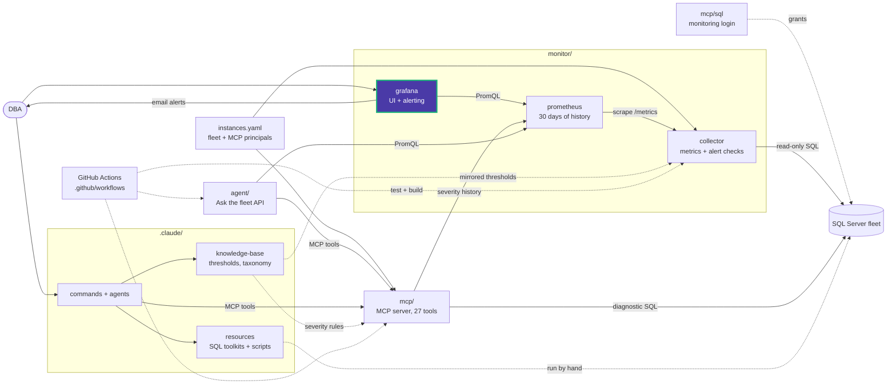

# monitor/grafana/provisioning/alerting

Grafana-managed alerting. Rules are evaluated every minute against Prometheus.

| File | Contents |
|---|---|
| [data-eyes-alerts.yml](data-eyes-alerts.yml) | The 6 alert rules |
| [contact-points.yml](contact-points.yml) | Email contact point `grafana-default-email` (to `GRAFANA_NOTIFICATION_ADDRESSES`) and the notification policy |

## Rules

| Rule | Fires when | Severity |
|---|---|---|
| `DataEyesExporterUnavailable` | Prometheus cannot scrape the collector for 2 min | critical |
| `SqlServerUnavailable` | A SQL Server is unreachable for 1 min | critical |
| `DataEyesDiagnosticFailing` | A collection group or check fails for 2 min | warning |
| `SqlServerWarning` | A check is at Warning | warning |
| `SqlServerCritical` | A check is at Critical | critical |
| `SqlServerEvents` | An event check fired in the last 5 min | warning |

## Policy

Grouped by folder, rule and `sql_instance`: wait 30 s, group interval 5 min, repeat
every 4 h while firing.

Check thresholds are not set here; they belong to the collector
([checks.yaml](../../../collector/checks.yaml)). These rules only react to the
severities it exports.

<!-- project-map:start -->
## Where this fits

- The rules query the severities the collector exports through Prometheus; thresholds belong to `monitor/collector/checks.yaml`.
- Email goes to `GRAFANA_NOTIFICATION_ADDRESSES` with the SMTP settings in the root `.env`.



The highlighted box is this folder. Solid arrows are runtime calls; dotted arrows are configuration, mirrored rules, or manual use.

### In the repository

```text
data-eyes/
├── .claude/                                  Claude Code toolkit
├── .github/                                  GitHub configuration
├── agent/                                    "Ask the fleet" API
├── assets/                                   Logo
├── mcp/                                      MCP server (27 read-only tools)
├── monitor/                                  Collector -> Prometheus -> Grafana
│   ├── collector/                            SQL diagnostics exporter
│   ├── grafana/                              UI and alerting
│   │   ├── dashboards/                       Fleet Overview
│   │   └── provisioning/                     Applied at startup
│   │       ├── alerting/                     6 rules, email, policy  ◀ you are here
│   │       ├── dashboards/                   Dashboard file provider
│   │       ├── datasources/                  Data Eyes Prometheus
│   │       └── plugins/                      None yet
│   └── prometheus/                           Scrape config, 30 days
├── .env.example                              Template for .env (Grafana, agent)
├── .mcp.json                                 Claude Code MCP registration (stdio, dev)
├── CLAUDE.md                                 Project instructions for Claude Code
├── README.md                                 Setup, configuration, security
├── docker-compose.yml                        The whole stack
└── instances.example.yaml                    Template for instances.yaml (fleet, MCP principals)
```
<!-- project-map:end -->
