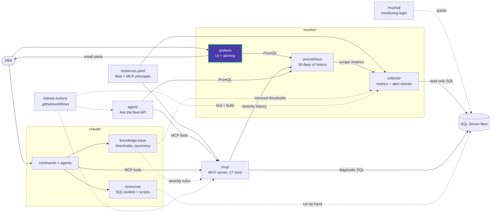

# monitor/grafana/provisioning/dashboards

[dashboard-provider.yml](dashboard-provider.yml) defines the **Data Eyes** file
provider:

- reads `/etc/grafana/dashboards` (the [dashboards](../../dashboards/) folder),
- checks for changes every 10 s,
- maps subfolders to Grafana folders,
- allows UI edits, which are saved only in Grafana's database.

The dashboard JSON itself lives in `monitor/grafana/dashboards/`, not here.

<!-- project-map:start -->
## Where this fits

- Loads `monitor/grafana/dashboards/` into Grafana.



The highlighted box is this folder. Solid arrows are runtime calls; dotted arrows are configuration, mirrored rules, or manual use.

### In the repository

```text
data-eyes/
├── .claude/                                  Claude Code toolkit
├── .github/                                  GitHub configuration
├── agent/                                    "Ask the fleet" API
├── assets/                                   Logo
├── mcp/                                      MCP server (27 read-only tools)
├── monitor/                                  Collector -> Prometheus -> Grafana
│   ├── collector/                            SQL diagnostics exporter
│   ├── grafana/                              UI and alerting
│   │   ├── dashboards/                       Fleet Overview
│   │   └── provisioning/                     Applied at startup
│   │       ├── alerting/                     6 rules, email, policy
│   │       ├── dashboards/                   Dashboard file provider  ◀ you are here
│   │       ├── datasources/                  Data Eyes Prometheus
│   │       └── plugins/                      None yet
│   └── prometheus/                           Scrape config, 30 days
├── .env.example                              Template for .env (Grafana, agent)
├── .mcp.json                                 Claude Code MCP registration (stdio, dev)
├── CLAUDE.md                                 Project instructions for Claude Code
├── README.md                                 Setup, configuration, security
├── docker-compose.yml                        The whole stack
└── instances.example.yaml                    Template for instances.yaml (fleet, MCP principals)
```
<!-- project-map:end -->
