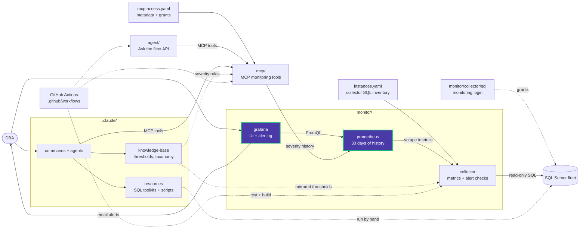

# monitor/grafana/provisioning/datasources

[datasources.yml](datasources.yml) provisions one datasource:

| Name | UID | Type | URL |
|---|---|---|---|
| Data Eyes Prometheus | `dataeyes_prometheus` | prometheus (proxy, POST, 30 s interval) | `http://prometheus:9090` |

It is the default and is not editable in the UI. Dashboards and alert rules refer to
it by UID, so keep the UID stable.

There is deliberately no SQL Server datasource. The fleet is defined once, in
`instances.yaml`, and reaches Grafana only through the collector's metric labels.

<!-- project-map:start -->
## Where this fits

- Points Grafana at the `prometheus` service. It is Grafana's only link to the rest of the stack.



The highlighted box is this folder. Solid arrows are runtime calls; dotted arrows are configuration, mirrored rules, or manual use.

### In the repository

```text
data-eyes/
├── .claude/                                  Claude Code toolkit
├── .github/                                  GitHub configuration
├── agent/                                    "Ask the fleet" API
├── assets/                                   Logo
├── mcp/                                      MCP monitoring tools
├── monitor/                                  Collector -> Prometheus -> Grafana
│   ├── collector/                            SQL diagnostics exporter
│   ├── grafana/                              UI and alerting
│   │   ├── dashboards/                       Fleet Overview
│   │   └── provisioning/                     Applied at startup
│   │       ├── alerting/                     6 rules, email, policy
│   │       ├── dashboards/                   Dashboard file provider
│   │       ├── datasources/                  Data Eyes Prometheus  ◀ you are here
│   │       └── plugins/                      None yet
│   └── prometheus/                           Scrape config, 30 days
├── .env.example                              Template for .env (Grafana, agent)
├── .mcp.json                                 Claude Code MCP registration (stdio, dev)
├── CLAUDE.md                                 Project instructions for Claude Code
├── README.md                                 Setup, configuration, security
├── docker-compose.yml                        The whole stack
└── instances.example.yaml                    Template for collector SQL inventory
```
<!-- project-map:end -->
