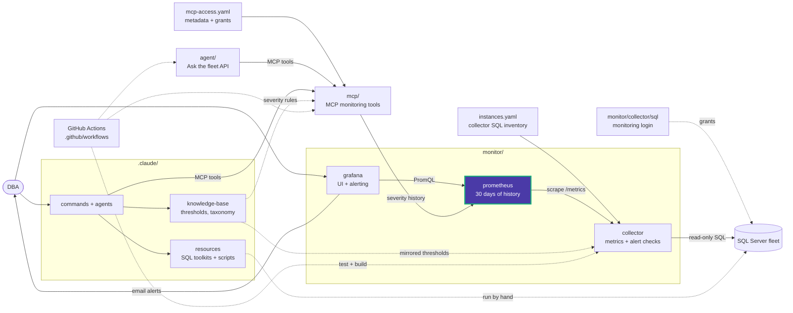

# monitor/prometheus

Prometheus configuration, mounted read-only at `/etc/prometheus` by the root
[docker-compose.yml](../../docker-compose.yml). Prometheus stores 30 days of history
in the `prometheus-data` volume.

| Path | Contents |
|---|---|
| [prometheus.yml](prometheus.yml) | Scrapes the collector (`collector:8090`) and Prometheus itself every 30 s; loads `rules/*.yml` |
| [rules/](rules/) | Recording rules |

There are no alerting rules here. Grafana does the alerting by querying this
Prometheus (see [monitor/grafana/provisioning/alerting](../grafana/provisioning/alerting/)).

Validate after editing, as CI does:

```powershell
docker run --rm --entrypoint promtool -v "${PWD}/monitor/prometheus:/etc/prometheus:ro" prom/prometheus:v3.13.4 check config /etc/prometheus/prometheus.yml
docker compose restart prometheus
```

<!-- project-map:start -->
## Where this fits

- Scrapes the collector every 30 s and keeps 30 days.
- Queried by Grafana (its only datasource), MCP's history tools and the agent.
- CI validates this config with promtool.



The highlighted box is this folder. Solid arrows are runtime calls; dotted arrows are configuration, mirrored rules, or manual use.

### In the repository

```text
data-eyes/
├── .claude/                                  Claude Code toolkit
├── .github/                                  GitHub configuration
├── agent/                                    "Ask the fleet" API
├── assets/                                   Logo
├── mcp/                                      MCP monitoring tools
├── monitor/                                  Collector -> Prometheus -> Grafana
│   ├── collector/                            SQL diagnostics exporter
│   ├── grafana/                              UI and alerting
│   └── prometheus/                           Scrape config, 30 days  ◀ you are here
│       └── rules/                            3 recording rules
├── .env.example                              Template for .env (Grafana, agent)
├── .mcp.json                                 Claude Code MCP registration (stdio, dev)
├── CLAUDE.md                                 Project instructions for Claude Code
├── README.md                                 Setup, configuration, security
├── docker-compose.yml                        The whole stack
└── instances.example.yaml                    Template for collector SQL inventory
```
<!-- project-map:end -->
